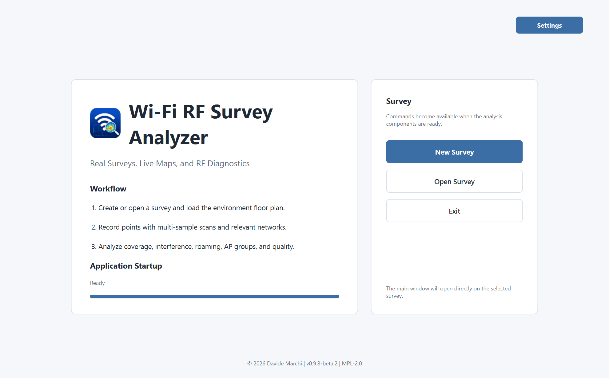

# Wi-Fi RF Survey Analyzer

Desktop application for Wi-Fi RF surveying, live map analysis, AP modeling,
survey-quality review, RF recommendations, and offline HTML reporting.

Wi-Fi RF Survey Analyzer is built for practical field surveys: load a floor
plan, collect real Wi-Fi measurements, preserve raw scan evidence, model
physical APs, review survey quality, and export explainable RF maps.



## Download

- **Download latest release:** use the
  [GitHub Releases page](https://github.com/beastmen84/wifi-rf-survey-analyzer/releases/latest).
- **Windows build available:** public ZIP builds expose
  `WiFiRFSurveyAnalyzer.exe`; older beta artifacts may still contain the
  historical `WifiHeatmap.exe` name.
- **Not a penetration testing tool:** this app is intended for authorized Wi-Fi
  surveying, troubleshooting and RF analysis, not offensive assessment.

## Release Status

- Current source version: `v1.4.0`
- Release type: stable public source release
- Active UI: PySide6
- Main entry point: `main.py`
- Current survey format: CSV plus linked `.scan` raw-data sidecar
- Windows package: generated in a separate release step from the same source
  tag. Public builds use `WiFiRFSurveyAnalyzer-v<version>-win64.zip`.
- Project license: MPL 2.0 (`MPL-2.0`)

`v1.4.0` adds annotation layers, symbols and legends to imported plans, with the
original image/PDF fixed underneath. Doors, windows and structural editing stay
exclusive to Draw Plan. It also adds rack/switch/port inventory, a clearer Design
Mode palette, responsive controls, centered JPEG exports and a Recommendations
tab that leads with practical actions. Direct AP placement retains symbol links;
JPEG export protects the imported source and PDF margins render white. See the
[1.4.0 release audit](docs/AUDIT_1_4_0.md) for validation and its limits.

`v1.3.0` added Draw Plan / Load Plan setup, a layered plan editor with straight and
curved structure, physical wall thickness/materials, annotations and AP symbols,
shared selection, legends, fixed-origin resizing and clean print/JPEG exports.
Wall materials are descriptive and do not infer RF attenuation. See the
[1.3.0 release audit](docs/AUDIT_1_3_0.md) for validation and its limits.

`v1.2.0` added a fixed Wi-Fi receiver per survey, guided measurement capture and
separate acquisition reliability, signal stability and observed coverage.
Relevant networks are chosen before reviewing a capture; compact review cards
and immediate point popups make the results easier to read. `v1.1.0` introduced
the final Analysis workflow and offline HTML map and analysis reports.
The pre-release [data-accuracy audit](docs/AUDIT_1_1_0.md) records the precision
fixes and their verification, including live scan-freshness checks. Controlled
field validation, receiver calibration and 6 GHz hardware checks remain separate
from these software checks.

## Core Features

- PDF/image floor-plan loading with scale calibration.
- **Print Plan**, at the right of **Project**, opens a print preview of the clean
  plan with committed drawing/text/door/window/marker edits, including unsaved
  changes. Survey points, operational AP overlays, grid, masks and heatmaps are excluded;
  Wi-Fi AP drawing symbols are part of the clean plan.
  The whole plan fits one page with its proportions preserved; select paper and
  printer in the preview. Printing does not require saving the survey.
  A graphical reference in m/ft uses the calibrated plan scale and follows paper
  fitting, so its length stays meaningful after changing page size/orientation.
  Uncalibrated plans explicitly report that their scale is unavailable.
- **Save as JPEG**, beside **Print Plan**, exports the same clean plan and scale
  reference. Choose A5–A0, Letter or Legal, portrait/landscape and 150/300/600 DPI;
  preview the page and exact pixel dimensions before choosing the file. The JPEG
  centers the plan horizontally and vertically, preserving proportions. Draw Plan
  fits the visible drawing and removes unused white sheet space; Load Plan fits
  the whole imported image. This changes only the exported view, preserving
  survey coordinates and calibration. Space is reserved for the scale reference.
  The file stores its print resolution and includes unsaved drawing edits. Use actual-size
  printing in your image application to retain the selected paper dimensions.
  Drawn plans render their lines, curves, annotations and text directly at the
  output resolution, including in Print Plan. Use **600 DPI · Fine detail** for
  small text and fine lines; A3 at 600 DPI is **7016 × 9921 px**. Imported bitmap
  detail depends on the source image. A 150-megapixel page limit supports 600 DPI
  through A2; A1/A0 use up to 300 DPI, with the limit explained in the dialog.
  In either plan mode, **Include legend pages** adds automatic symbol tables to printing
  and exports separate `-legend-01.jpg`, `-legend-02.jpg`, … images at the same
  paper size, orientation and resolution. Preview each page before exporting.
- New Survey asks for **Draw Plan** or **Load Plan**, metric/imperial units and
  the Wi-Fi adapter. **Draw Plan** creates a gridded sheet with configurable
  dimensions and an automatic scale; Design Mode and Layers are available.
  **Load Plan** uses an image/PDF selected during setup and requires scale
  calibration before editing overlays. **Annotations**, **Layers** and **Legend**
  are available above the fixed imported background: text, markers, desks,
  numbered symbols, racks and Wi-Fi AP symbols. Structural drawing, wall editing,
  doors/windows, Resize and structural Fill/Auto Fill remain Draw Plan-only.
  Annotation layers keep their visibility, order, locks and undo/redo; clean
  print/JPEG and Live/HTML maps composite visible overlays on the original plan.
  The source image/PDF is never overwritten or replaced with a generated PNG.
  AP Groups retains direct AP positioning and adds Assign AP symbol in its
  position menu; the legend and rack port tables are available in both modes.
  Manual Boundaries, measurements, Live Map, Analysis and clean print/export
  remain available in both modes. The plan source is fixed for the survey:
  Project has no Load Plan action; create another survey to use a different plan.
  Canceling setup/file selection or failing to decode a file preserves the current
  survey. Existing projects retain their source on reopening.
  Starting a new survey while another is
  open first asks to save the current survey, discard changes, or cancel.
  The grid overlay shows the current square size directly on the map.
- Blank sheets start at **35 × 25 m** or **115 × 81 ft**, depending on the units.
  After customizing the dimensions, switching m/ft converts the same physical size.
  Blank-sheet dimensions are preserved with
  the generated PNG on save/reopen. The blank sheet has a bottom-left
  Design Mode toolbar for rectangles: right-drag shows live m/ft
  dimensions; a right-click opens exact dimensions, followed by another
  right-click to place the preview. Left-drag pans even when the whole sheet is
  visible; move it away from the fixed Design Mode panel to reach covered areas.
  **Fit** recenters the complete sheet. Color and undo/redo are
  available. Nearby corners and edges snap automatically, with orange target
  indicators; the grid button adds snapping to the displayed grid. Hold Alt to
  suspend snapping. Numeric placement moves the shape without changing its size.
  Grid snapping considers every real vertex, including all corners of rotated
  shapes and either endpoint of a line, and chooses the nearest valid grid
  intersection. Moving selections use their actual vertices. The orange marker
  identifies the snapped vertex; dimensions and angles remain unchanged.
  During a drag, the moving sides also align with overlapping sides of existing
  shapes, even when the cursor extends beyond them. The starting corner stays
  fixed and orange guides identify the height/width alignment.
  Select Eraser to right-click one highlighted side, or right-drag an area to
  erase every whole segment it touches on release. Red previews show the affected
  sides and their count. Each deletion can be undone/redone as one action.
  Design Mode opens with no tool selected. Esc cancels the current operation and
  deselects its tool while leaving the panel open; Esc in the neutral state closes
  it. During held-R rotation, Esc first restores the previous orientation.
  Right-click capture resumes only after leaving Design Mode.
  Drawings remain editable after save/reopen and appear in PNG/Live/HTML maps.
  The survey grid fades inside perimeters closed by the current segments,
  including joined, concave and overlapping shapes. Opening a perimeter with
  the eraser restores its normal grid; undo restores the closed appearance.
  Fading also recognizes enclosures formed by the physical wall thickness,
  including curved joins with disconnected reference endpoints. It preserves
  real gaps and evaluates each visible layer independently. This decorative
  mask does not join reference lines, change dimensions or define editable rooms.
  This grid styling stays in the survey view and is not baked into exported maps.
  The shapes are visual plan geometry; RF findings still use measured data.
- **Layers** is a collapsible column at the right of a Draw Plan or Load Plan Survey, available even with
  Design Mode closed. It reserves its own space beside the plan. Existing drawings
  belong to **Layer 0**, which can be renamed and locked but stays visible and
  cannot be deleted. Add up to 32 layers, rename them, toggle visibility/locking,
  and use **Up/Down** or drag the rows to change their order: the top row is painted
  above the others. Click a row to choose the active layer. Drawing, selection and
  erasing work only on that layer; hidden or locked layers cannot be edited.
  **Move selection to layer…** transfers selected pieces to another visible,
  unlocked layer. Doors/windows follow a transferred supporting wall; unsupported
  openings cannot be transferred on their own. The header's undo/redo controls
  also work with Design Mode closed. Layer changes support undo/redo,
  and all layers, including hidden content, survive save/reopen.
  Structural intersections, joins and closed rooms are calculated separately for
  each layer. Desks, symbols, markers and text can use visible walls in other
  layers as reference snap targets; desk/symbol distances also use those walls.
  These references do not join or edit the other layer's structure. Explicit
  Boundaries Fill/Auto Fill uses the active layer's closed rooms; the resulting
  RF mask remains independent of layer visibility. Survey points and operational
  AP markers remain independent too. Live Map, saved generated PNGs, HTML reports,
  Print Plan and Save as JPEG use the visible drawing layers in the same order.
  Clean print/JPEG retain their exclusion of measurement/AP/heatmap overlays.
- **Wall thickness** is reviewed during Draw Plan construction. After drawing a
  rectangle, line, circle or arc, a diagram shows its numbered, clickable sides
  with individual thickness fields in survey units. This happens on final
  right-drag release or the final placement click after entering dimensions.
  Select a side in the diagram or table; zero keeps a thin reference line.
  Closed-room dimensions remain internal and thickness grows outwards. Open
  lines/arcs offer an explicit left/right choice. Shared sides inherit the already
  placed wall depth, including attachment at its outer physical face. Orange ↔
  identifies shared sides. Changing their depth requires acknowledging that the
  existing shared wall will also change; connected rooms may translate while
  preserving internal dimensions. Differently colored/partially overlapping
  supports also inherit the common wall. Incompatible layouts are rejected.
  While placing a new form, existing walls and rooms stay fixed: the new form
  moves to the outer physical face instead of flipping or relocating its support.
  The review diagram shows the resulting positions before confirmation. If the
  unchanged-size form cannot fit between fixed supports or inside the sheet,
  placement is rejected. Ordinary editing of an existing layout retains its
  separate room-anchor rules. Material hatches remain aligned while panning,
  including at fractional display scaling.
  Cancel discards the proposed piece. Placement and thickness are one undo step.
  With **Select**, double-click in the empty interior of a closed area (left or
  right button) to reopen its sides. Annotation/text hits open their properties;
  stroke hits retain curve editing. The wall icon
  edits selected structural sides. Diagram numbers are temporary editor labels.
  Compatible shared faces are cut/picked together; deleting a divider rebuilds
  its jambs or continuing perimeter. Physical bounds, apertures, move/rotation,
  undo/redo, layers, saved plans and print/JPEG/HTML rendering share the same solids.
  Object clearances use physical faces. Existing depth is preserved exactly when
  merely reviewing properties, including when feet are rounded for display.
  Room separation must precede RF captures/manual masks; coordinate-only AP
  placements must first be converted to drawing symbols. Previously converted
  reference profiles retain their coordinate meaning when reopened. Their derived
  usable areas remain separate from analytic reference areas; curves are approximate.
  Invalid radii, incompatible room constraints and sheet overflow are rejected.
  Plans using thickness require drawing/layer format 2 support; rack inventories
  additionally require annotation format 2 / layer format 3. Legacy drawings
  retain their earlier formats until these features are used.
- **Wall materials** are selected per side in the same Wall Edit dialog. Select a
  numbered side or table row, set a positive thickness, then choose **Material**
  and **Appearance** below the table. The catalog includes wood, hollow clay blocks,
  solid bricks, concrete blocks, aerated concrete, plasterboard, concrete,
  reinforced concrete, stone, glass, metal and insulating panels, plus Unspecified.
  Automatic appearance supplies a light material color and schematic hatch;
  override it with solid, diagonal, cross, stipple, staggered blocks, grid or paired
  diagonal lines. Swatches and the side diagram preview the choice immediately.
  **Apply to all sides**, below Material, copies that material to the walls of
  the current shape with positive thickness. Each side keeps its depth and
  appearance. In a multi-shape selection, choose a side belonging to one complete
  shape; an ambiguous shared side requires opening that shape individually.
  Shared faces inherit the material/style too; changing either requires confirming
  the update to the existing wall. Material edits preserve dimensions and RF
  coordinates, survive save/reopen and drawing operations, and form one undo step.
  The **Priority** column lets a wall keep its material at overlapping joints
  on the same layer. Checked walls win over unchecked walls; equal priority
  favors the thicker wall, with a stable style order for exact ties. Priority
  follows both shared faces and is saved with the wall. **Apply changes** commits
  thickness, material, appearance and priority together. This visual setting does
  not change room dimensions or RF calculations. Covered end fragments at shared
  corners join their continuous side, while real T dividers remain separate.
  The editor, visible layers, Live Map, HTML, Print Plan and JPEG use the same
  vector patterns, clipped to wall bodies and door/window openings. Existing
  walls retain their neutral appearance until assigned a material. These are
  descriptive drawing properties and schematic patterns, without automatic RF
  attenuation or a claim of standardized construction symbols.
- Missing generated Draw Plan images can be recovered from validated saved vectors
  and canvas extents. Calibration and coordinates are preserved; saving recreates
  the PNG. Imported Load Plan images require their original image file.
- **Project → Resize** changes a Draw Plan page from its fixed top-left origin.
  Width changes only at the right; height changes only at the bottom. Calibration,
  RF/AP coordinates and grid spacing remain unchanged. Shrinking cannot cut any
  drawing layer (including hidden layers), physical wall, measurement, AP or
  Boundaries mask. Resize shares drawing undo/redo; restoring an older size also
  protects points/masks added later. Save updates the generated plan PNG. A valid
  calibration is required; Load Plan images cannot be resized with this action.
- **Grid square size** is configurable in New Survey: default **1 m** or
  **3 ft**, with **0.1 m** steps or **whole feet**. The physical size is saved in
  the survey and used by the visible grid and every snap tool. Right-click the
  main **Grid** button to change it later. Unit changes round to the input's
  precision. Older surveys keep their automatic spacing until explicitly edited.
- Intersections split editable strokes into individual fragments, including T
  joints and overlapping endpoints. Erase deletes only the chosen fragment.
  Line draws in any direction, including diagonals, by right-drag, or asks only for a length
  before cursor-following placement.
  Exact Line lengths are useful lengths beyond a physical attachment wall. The
  covered end portion is added internally while the snapped reference stays
  fixed: 1.30 m beyond a 0.10 m wall stores a 1.40 m reference segment and exposes
  1.30 m. Preview, drag readout, hover quotes and straight side lengths show the
  useful span. Already exposed ends and collinear/shared walls are not counted
  again. Alt retains literal placement; an exact useful length that cannot fit
  the sheet or the other wall is rejected without a partial edit.
  Hold **Shift** during a line or initial arc-chord drag to constrain it
  horizontally or vertically from its fixed start. Press/release Shift also
  updates a stationary preview. Magnets remain active on that axis; **Alt+Shift**
  releases magnets while retaining the axis constraint. Arc bending, circle
  sizing and rotated numeric placement retain their existing behavior.
  Older plans with microscopic rounding residues remain editable when adding
  diagonals. **R** rotates both Line and Rectangle
  placement previews by 90 degrees while preserving their dimensions.
  Select Structure uses right-click for one fragment or a right-drag box for all touched
  fragments. **R** rotates the selection around its bounding-box center; **M**
  starts a rigid cursor-following move, confirmed with right-click or cancelled
  with Esc. R also rotates during a move. The selection's box snaps to unselected
  geometry or the optional grid; Alt suspends snapping. Edits share undo/redo,
  recompute closed areas and survive save/reopen, including older drawings.
  A click within about six screen pixels of a stroke picks the single fragment
  first; a click farther inside a closed region selects all its boundary pieces
  and shows its area in **m²/ft²**, including nested holes. Open-space clicks keep
  the selection. Single lines show length, circles radius, and arcs length,
  radius, chord and sagitta. Circular areas use analytic geometry. Selection
  commands are listed one per line in the palette and measurement panel.
  If a move, rotation or erase removes a junction, contiguous straight fragments
  with the same color rejoin automatically. Same-color straight overlaps and
  duplicates also unite, removing artificial cuts at their old endpoints. Cuts
  remain at real junctions, curve contacts, corners, gaps and color transitions;
  overlapping strokes of different colors stay separate.
  Tap and release **R** for a 90-degree turn. Hold **R** and move around the
  orange center for **5-degree steps**: the object stays frozen in place and
  shows equivalent angles such as `(+315° / -45°)`. Release R to apply, or Esc
  to restore its previous orientation. This works on selections, moving groups
  and Line/Rectangle placement previews. Out-of-sheet orientations appear red
  and are rejected. Rotated oblique strokes retain real intersections, snapping,
  partial erasing, closed-area detection and saved/exported geometry.
- Design Mode separates **Structure** from **Annotations**, with independent
  erasers and an annotation-only selection shortcut. The main **Select** defaults
  to **Include annotations**: a closed-room click selects its boundary, contained
  objects/text and hosted openings; a drag box combines touched structure and
  annotations. M/R/Del act on the group in one undo step, including exact bound
  AP-symbol positions. Objects crossing a room boundary/hole are not implicitly
  added by an interior click. Turn off Include annotations for structure-only
  selection; hosted doors/windows still follow their supporting walls. All these
  operations stay on the active layer. Hidden/locked layers and RF measurement
  points remain independent. The palette, toggle and measurement panels stay
  anchored to the viewport during zoom and pan. **Marker** draws
  dashed freehand or grid-following paths with its own color and graphical width.
  **Door** supports single, double, sliding and frame-only variants; **Window** uses a simple
  window symbol. Choose width before placement, then right-click on a straight
  wall, including oblique walls.
  Point near the wall midpoint to center a door/window, including when the wall
  is only slightly wider than the opening; point near a wall end to anchor a jamb.
  Doors have independent hinge and opening-side choices shown as eight
  configuration icons (four single, two double, sliding,
  frame only). **Frame only** shows the jambs without a leaf or swing arc.
  On walls with physical thickness, frames span both faces and sit on the wall
  centerline; windows and sliding frames adapt to the same depth. Click anywhere
  across the wall body to position them. Existing openings adapt when thickness
  changes, retaining their saved reference coordinates and width.
  Only swing arcs are dashed; door leaves remain solid.
  **Desks** offer square, rectangular, L, equal-sided L and round variants, with
  editable dimensions and L desktop depth. **Symbols** separates numbered
  circle/square/diamond/triangle markers, **Rack / Wi-Fi AP** apparatus and generic
  X/plus/star/arrow signs. Both have independent outline color,
  outline width and optional fill color. Icon menus choose their variant; the
  centered preview follows the cursor and right-click places it. **R** rotates
  non-round objects by 90° before placement or in selection/move. Use annotation
  selection to pick the outline or interior, move, edit or erase these objects.
  They retain drawing/grid magnets, undo/redo and save/reopen, and appear in
  PNG, Live/HTML and Print Plan without changing rooms, areas or RF analysis.
  Placement, individual selection and movement show up to two nearest clearances
  to structure (one per principal direction), measured from the actual footprint
  rather than its center. Dashed guides and m/ft values support rotated/L/round
  objects and curved walls; a red indicator identifies structural intersections.
  These temporary guides are excluded from saved plans and exports.
  Short distances remain labeled: when a number cannot fit between the object
  and the wall, it is placed outside the object with a leader line.
  Numbered markers use a separate sequence for each shape, unique across all
  layers. Numbers stay attached to their objects and are not reused after deletion.
  Numbers remain upright, fitting inside the shape where readable or using an
  external badge. Disable **Automatic number** for an unnumbered marker.
  **Analysis toolbar → Legend** creates automatic per-shape tables with editable
  descriptions; hidden/locked layers can be inspected but not edited there.
  Existing unnumbered markers remain unchanged until explicitly numbered in
  Legend. Printed/exported tables include only visible layers.
  In either plan mode, **Assign AP symbol…** in AP management binds a physical AP group
  to a previously placed Wi-Fi AP symbol. One symbol belongs to one AP and vice
  versa; an assigned symbol has a blue fill and AP label. Its center supplies
  the AP position for analysis, including after movement. Unassigning/deleting it
  clears that position; undo restores it. Existing coordinate placements can be
  converted explicitly without moving them. Hiding a layer hides its artwork,
  while retaining AP positions for RF analysis. Load Plan also keeps direct AP
  map placement. If an AP already has a symbol, a direct placement moves both in
  one undoable operation; hidden or locked symbol layers must first be made
  visible and unlocked.
  Apertures hide only the covered wall ink: room closure, internal area
  and Boundaries Fill/Auto Fill retain the complete structural geometry.
  Select annotations to move with **M**, delete with **Del**, or edit by right
  double-click / Properties. **R** rotates markers/text by 90° or reverses a swing
  door's opening side. Attached openings follow rigid host moves; deleting their
  support also deletes them in the same undoable edit. Overlapping openings and
  invalid placements are rejected. PNG, Live Map and HTML use the same symbols.
  Structure and Annotations also have their own **eraser**: right-click removes
  one item and right-drag removes the touched items in that layer, including text
  for annotation erasing. Undo restores the same objects and their wall ink.
- **Rack inventory** is optional in either plan mode: select a Rack symbol and set
  **No. switches**, then open **Rack details** to name the rack and set each
  switch's **No. ports**. Zero means unspecified. **Analysis toolbar → Legend → Switches
  and ports** lists racks and switches; port numbers are automatic and each port
  has a free description. Retained ports keep their descriptions when counts
  change; accepting a reduction removes descriptions for the removed ports.
  Inventory follows the symbol through moves, rotations, layer changes,
  save/reopen and undo/redo. Hidden or locked rack data is read-only in Legend;
  printing/JPEG adds dedicated tables for switches in visible racks. These data
  document the installation and do not change RF calculations.
- With a drawing tool active, hovering over a segment shows the distances from
  endpoint **A** to the cursor and from the cursor to **B**, with matching colored
  dimension lines. For door/window placement and movement, A/B instead show only
  the free gaps from the opening's two jambs to the host ends. Their dimension
  strokes stop at the jambs, so a 20 cm corner clearance is measured at the edge
  of the opening. Quotes use the containing segment's ends, including room
  junctions; collinear fragments are joined only when the opening spans a
  normalization cut. Genuine wall gaps remain separate.
  Quotes use survey m/ft units and stay out of saved/exported geometry.
  **Segment midpoints** and **room centers** are snap targets alongside corners
  and edges. Shapes, text and openings can also snap from their own center; for
  doors/windows this is the midpoint of the opening on the wall. Room centers
  stay inside usable regions, including concave rooms or rooms with holes.
  The grid toggle controls only grid snapping; drawing magnets remain active.
  **Alt** suspends both drawing and grid magnets, while hosted openings still
  require a supporting wall.
- Design Mode **Text** opens a multiline editor with font, size, bold/italic,
  alignment, color, outline and a live preview. Click the sheet with the right
  button to open it; after OK the label follows the cursor until another right
  click places it. R tap/hold rotates its placement preview. Select Annotations
  selects labels alone or with other annotations to move with M or delete with **Del**. Deletion
  is one undoable edit. Right-double-click selected text, or use **Edit selected
  text**, to reopen its editor. Text remains editable after save/reopen and
  appears consistently in generated PNGs, Live Map and both HTML report types.
  Selected text has a thin contrasting outline and dashed selection frame;
  text stays above furniture fills within its layer in the editor and exports.
- Custom colors explicitly saved in the color picker and the last accepted
  drawing-tool colors persist between sessions in application settings. Existing
  survey objects retain their own styles; changing preferences does not dirty a
  survey or change its geometry.
- Design Mode **Circle** uses a right drag from the center to set the radius,
  or a simple right click to enter it precisely. **Circular arc** uses a right
  drag from A to B for the chord: release, move the pointer to set the bend and
  right-click to confirm. A simple right click instead accepts the chord,
  perpendicular sagitta and side, so the same curve can be reproduced elsewhere.
  Numeric arc previews support R tap/hold; a single circle has no rotation.
  In a mixed/group selection, its center follows the group's rotation.
  Select and right-double-click a curve,
  or use the pencil action, to inspect/change its dimensions. Curves split at
  intersections, rejoin obsolete cuts, and support snapping, partial erasing,
  selection, M, R, Del and undo/redo. Closed curved perimeters also fade the grid
  and work with Boundaries Fill/Auto Fill. Their editable geometry survives
  save/reopen and appears in PNG, Live Map and HTML reports. The measurements
  panel stays at the top right of the drawing viewport, opposite the grid scale.
  With grid snapping active, radius/chord endpoints snap to visible grid
  intersections, and bending makes the arc pass through the chosen grid point
  with its chord fixed. Existing corners take priority and show an orange marker.
  Turn grid snapping off or hold Alt for continuous sizing. Numeric arrows
  adjust by 0.01 m/ft.
  Numeric previews follow slow cursor movements without sticking to the grid.
- On generated blank sheets, **Boundaries** includes **Fill** for one closed
  drawn room and **Auto Fill** for all closed drawn rooms. Fill uses a right
  click inside the area and respects nested rooms; open perimeters do not fill.
  Both add to the existing analysis mask. These controls are hidden on imported
  plans, which retain the existing brush/eraser tools.
- Measurement-point capture with repeated Wi-Fi scans.
- Fixed receiver selection, a short preparation and five scan attempts, followed
  by an explicit Save, Repeat or Discard review. Review and reports distinguish
  acquisition reliability, signal stability and observed coverage.
- Raw scan preservation in a linked `.scan` sidecar file.
- Relevant SSID selection for focused quality checks and map interpretation.
- AP Group Manager for BSSID grouping, aliases, roles, metadata, expected
  channels, analysis-channel overrides, and physical AP positions.
  Click the circle in the first column to confirm that the listed BSSIDs belong
  to one physical AP: green with a check means approved. Save to keep the change.
  Changing BSSIDs, alias, role, position or metadata clears approval; accepting
  unchanged values keeps it. Click a green circle to revoke approval.
  When AP Memory needs review, the first column shows **M** instead of a circle.
  Resolve Memory first: accept recalled data, update from memory, or keep current
  data. The circle then shows whether the group needs physical confirmation.
- Persistent AP Memory for reusing known AP metadata and physical-group approval
  across surveys. Approval is restored only for the exact same BSSIDs; a subset,
  extra BSSID or local revocation requires confirmation. Older memory records
  without approval need an initial confirmation using the circle.
- Survey Quality Dashboard with point-rescan findings, AP model diagnostics,
  clickable KPI point lists, and prioritized "what to fix next" guidance.
- Live Coverage, Interference, AP Channels, and Dominant AP maps.
- A final Recommendations tab with local rules for channel plans,
  coverage, AP dominance, client roaming and missing survey evidence. Findings
  explain their confidence and link back to measured points.
  Physical-group confirmation is requested once per group transmitting a relevant
  SSID. Other networks remain individual RF neighbors without an approval request;
  their measured channel, width and evidence quality still affect recommendations.
- Optional manual Boundaries masks for limiting continuous live maps and HTML
  exports to the useful survey area when the floor-plan shape or measured
  perimeter needs explicit control.
- Shared, sectioned tooltips for survey points, Wi-Fi AP markers and live-map
  points, with point-local signal, confidence, channel and AP evidence where
  available.
- Standalone HTML export from Live Map, with the same renderer and active
  filters, a numbered map, linked point evidence and visible diagnostic warnings.
- Complete HTML analysis reports with a concise summary, prioritized actions,
  visible evidence limits and expandable measurement/parameter sections.
  Both report types work offline as one file and support printing from the browser.
- Compact Recommendations controls: coverage target and report actions remain visible;
  evidence thresholds and channel candidates sit in expandable Analysis settings,
  with confidence/point thresholds summarized and applicable missing-channel
  warnings visible. The full channel lists remain in settings and their tooltip.
- English, Italian, French and Spanish UI, Help Center and report wording,
  covering the operating workflow and detailed option behavior.

## Main Workflow

1. Start a new survey or open an existing survey CSV.
2. Choose units, Wi-Fi adapter and **Draw Plan / Load Plan** in New Survey.
   Draw Plan asks for sheet/grid dimensions; Load Plan asks for an image/PDF.
3. Calibrate the imported plan before using real-world distances. Draw Plan
   already has its scale from the sheet dimensions.
4. Place measurement points on the floor plan, roughly every 2-3 m for
   precise surveys when the space allows.
5. Hold the device still during the short preparation and five guided scans.
6. On the first capture choose relevant SSIDs before the review appears, then
   save, repeat or discard the measurement using feedback for the chosen scope.
7. Review acquisition reliability, signal stability and observed coverage
   separately. Reopen **Measurement details** from a selected saved point, then
   use Survey Quality to fix point-level issues first.
8. Review AP groups, metadata, channel overrides, and AP positions. Confirm the
   groups transmitting relevant networks using the first-column circles, then Save.
9. Use Live Map views to inspect coverage, interference, channels, and roaming.
10. Open Recommendations, set the coverage target and evidence
    requirements, and review the suggested actions and their supporting points.
11. Use **Export Map** in Live Map or **Export report** in Recommendations to save
    standalone HTML. Open the
    report in a browser to inspect details, follow point links or print it.

## Data Model

Surveys are stored as readable CSV files with metadata comments at the top. Raw
scan rows are stored separately:

```text
survey.csv
survey_raw_data.scan
```

The CSV stores aggregated measurement-point data. The linked `.scan` sidecar is
part of the current survey format and preserves the raw scan samples used to
build those measurements.

Saving prepares the CSV, raw data and any generated images before replacing
the existing files. Failed saves restore the previous file set. If the app is
interrupted during replacement, reopening the CSV recovers the pending save.
Files named `.<survey.csv>.save.*` support locking/recovery; keep pending
recovery files beside the survey until it has reopened successfully.

If a new survey is saved without replacing the generated blank plan, the app
also writes a same-name PNG beside the CSV, for example `survey.csv` and
`survey.png`. If that generated PNG is later replaced by a real floor plan and
the survey is saved again, the obsolete blank PNG is removed.

If a manual Boundaries mask is drawn, it is saved beside the survey as a
same-name `.boundaries.png` file and is reopened with the CSV. An empty or
cleared mask behaves as if no manual boundaries were present.

Stored survey metadata includes floor-plan path, raw sidecar path, scale
calibration, measurement system, selected receiver ID/name, relevant SSIDs, AP groups, AP roles, AP
metadata, AP positions, analysis-channel overrides, and product/schema version
fields.

New captures preserve the receiver, backend, scan lifecycle and BSS observation
timestamps in CSV/raw evidence. Measurement-point metadata also retains a
successfully completed scan with zero BSS, without inventing an RSSI value.
Older surveys remain readable; missing provenance stays unknown and cannot
authorize precise operational recommendations. Rescan those points when needed.

## Wi-Fi Scanning

New Survey asks for a fixed Wi-Fi receiver alongside units. A single adapter is
preselected; with multiple adapters a connected, ready receiver is suggested.
The saved adapter ID/name is restored on reopening, and the name appears in the
workspace footer. Adapter discovery runs in the background and can be refreshed.
An adapter can scan without joining a network. If no usable receiver is found,
connect or enable one and refresh; existing surveys remain readable.

All point captures and rescans use `lswifi` with that exact receiver ID. An
absent receiver or a failed native scan never silently switches hardware or
falls back to Windows `netsh`. A different receiver requires a separate survey.
Older surveys ask for an explicit receiver before their first new capture;
their existing rows retain their original provenance.

Native captures wait for scan completion and count only fresh, unique BSS
observations across five attempts. Failed requests and cached observations do
not become new samples. Saving a point also checks its receiver against the
survey selection, including raw samples and verified empty captures.

The guided capture displays actual scan progress and keeps results provisional
until **Save point**. Relevant-network selection and any missing/new-network
choices happen before feedback is shown; Save confirms that reviewed scope
without opening another selector. Discard is available during collection; the
current native request completes before the worker releases its resources. Repeating uses a
new, fixed set of five attempts. An existing point is preserved until its
replacement is saved; the app does not automatically repeat until RSSI improves.

The review and saved-point details separate three questions:

- **Acquisition reliability:** completed attempts, unique fresh observations,
  matching receiver and raw evidence. Missing history stays unverified or
  limited; completed scans do not imply that every AP was seen five times.
- **Signal stability:** variation within each strong BSSID/SSID/band candidate,
  requiring at least three verified fresh samples. A range of 12 dB or more is
  flagged. This does not detect device movement or certify receiver calibration.
- **Observed coverage:** the strongest median RSSI per relevant SSID against an
  explicit -70 dBm reference across detected bands. A missing SSID does not
  prove absent coverage. Channel and roaming advice remains in Recommendations.

The point table labels acquisition reliability explicitly and shows the three
axes for the selected point and in its tooltip. Offline HTML exports retain the
same distinctions in expandable point details. The Analysis report uses its
configured coverage target; point details and Live Map use the -70 dBm reference.
These presentation checks do not replace the RF engine's recommendation guards.

Preparation and scanning use a compact dialog; review expands only when needed.
Review cards place the main result on the left and smaller, wrapped details on
the right. Selected SSIDs are visible in the coverage card. Useful warnings are
shown directly; routine cache-exclusion notes and repeated explanations do not
need an extra disclosure. The review fits its content when screen space allows;
scrolling is retained for genuine overflow, without a redundant details toggle.
Survey hover summaries show up to four SSID names and a remaining
count; the point table retains the full list. Survey tooltips appear immediately
over the painted point, including its selection outline, and stay stationary
while the pointer remains there. They close immediately on exit or map gestures.
The popup does not intercept mouse input, has no automatic expiry and does not
use the standard Qt tooltip delay. In overlapping markers it retains the current
point until that point's outline is left. Pan, zoom and refresh close the popup.

The `netsh` compatibility/diagnostic scanner reads English, Italian, French and Spanish field labels,
preserves explicit band information, and reports command failures or timeouts.
It is an unverified snapshot with estimated dBm, so it cannot establish fresh
independent samples or authorize precise RF changes. Reports distinguish these
estimates from driver RSSI. SSID identity preserves case, spaces and original
bytes, and hidden BSS remain available as RF evidence.

The data model supports 2.4 GHz, 5 GHz, and 6 GHz observations. When explicit
band/frequency data is unavailable, the app uses conservative channel-based
inference only when the primary channel identifies a unique band. Contradictory
band/frequency evidence and unsupported channel geometry remain unknown. HT40
needs its secondary-channel direction; 80+80 and ambiguous 320 MHz layouts do
not produce a numerical overlap claim.

Survey Quality also flags points where fallback scanner data or missing
channel-width/frequency details may weaken channel-sensitive conclusions such
as Interference, 5 GHz width overlap, or future 6 GHz validation.
When available, connected-BSSID evidence is preserved with survey data for
roaming and sticky-client diagnostics.

## AP Modeling

AP groups represent physical access points rather than isolated BSSIDs. This
prevents guest/main SSIDs from the same AP being treated as mutual interference
when the AP is modeled correctly.

Automatic MAC-based groups are proposals. Verify their BSSIDs against the real
equipment, then use **Confirm physical AP group** in the group's alias menu.
Renaming an automatic group does not confirm physical identity. Unconfirmed
groups do not hide RF neighbors or authorize physical AP changes.

Supported AP roles:

- `internal`: managed APs that belong to the surveyed network.
- `external`: neighboring APs observed during the survey.
- `interferer`: APs treated as interference sources.
- `test/hidden`: APs intentionally excluded from user-facing analysis.

AP Memory stores known aliases, roles, metadata, channel overrides, and
compatible map positions in the application data folder. When known BSSIDs are
seen again, remembered AP data can be applied automatically and remains flagged
for review until confirmed or edited.

## Quality Review

The Survey Quality Dashboard is designed to be reviewed before trusting maps.
It separates measurement-point problems from AP model/setup diagnostics, so
users can fix scan evidence before interpreting live maps or HTML reports.

Current checks cover scan confidence, missing relevant networks, sparse or
unstable data, limited scanner details, connected-client roaming evidence, AP
metadata, AP Memory review states, missing AP positions, dominant-AP position
anomalies, and AP channel changes. Local-area AP groups can be scoped per
measurement point, so intentionally zone-only SSIDs are not treated as
whole-building requirements.

The dashboard uses KPI cards, filtered point lists, and detail dialogs to keep
large surveys readable. Full behavior and review guidance are documented in the
in-app Help Center.

## Live Maps And HTML Reports

Available live maps:

- Coverage
- Interference
- AP Channels
- Dominant AP / roaming

Coverage and Interference use continuous color scales. AP Channels and Dominant
AP use discrete legends with highlight/focus behavior. Map options are scoped
to the selected map type so only relevant controls are shown.

For AP Channels and Dominant AP maps, legend point lists can highlight and
focus a specific measurement point. Focus uses the configured Go to Point zoom
and centers the selected point in the live-map viewport.

Continuous Coverage and Interference maps can use Survey Bounds to reduce
visual extrapolation outside the measured area. When a manual Boundaries mask
exists, that mask defines the valid map area and Survey Bounds is enabled and
locked for live maps and report export.

HTML export uses the current live map renderer and options, includes the full
floor plan independently of viewport zoom/pan, and embeds the image and legend.
Numbered points open their evidence. A summary highlights weak measured signals,
interference risk or dominant-AP warnings; unknown RF geometry stays explicit.

## Recommendations

The final tab analyzes the whole current survey using deterministic local rules.
Select the relevant SSIDs and confirm AP grouping, roles and positions first.
Live Map filters do not restrict the analysis. The default list focuses on
operational recommendations: a specific joint channel plan first, then controlled
trials and on-site checks. This is a reading order by concreteness, not a computed
urgency or business-impact score. Each item states its type and confidence.

The section selector also opens **Prerequisites to review**, **Technical
observations**, or the complete findings. Data/model checks such as AP confirmation,
missing positions or measurements remain prerequisites; they do not become AP
configuration instructions. A compact summary links to the full **Survey Quality**
audit. When no operational advice is supported, the view explicitly requests the
prerequisite checks instead of declaring the network healthy.

Set the coverage target, minimum scan confidence, minimum supporting points,
and candidate channels usable by your APs. The default 2.4 GHz candidates are
1, 6 and 11. For 5/6 GHz, enter candidates explicitly to enable precise channel
proposals; an empty list keeps that band in review mode. Objectives apply to
the current app session and are included in exports.

Channel suggestions form one coordinated plan for the observed physical APs.
Unmanaged APs remain fixed neighbors. Incomplete width/frequency evidence,
changing channels, low confidence or conflicting metadata trigger verification
guidance instead of an unsupported precise change. Dominance and roaming
findings recommend controlled checks, with a power-balance trial only when
repeated measurements and alternative coverage support it.

Every finding includes an action and its limits. **Show supporting data** expands
the metrics and measured readings; point links return to Survey. Limits stay
visible when the readings are collapsed. These are advisory
results: the app applies no AP configuration changes and uses no AI or remote
service. Signal overlap is a modeled risk rather than a throughput/airtime
measurement. Placement checks do not predict an exact new location or power
level. Verify changes on site and repeat the referenced measurements.

HTML reports use the same ordering and retain all findings regardless of the
section selected in the app. Prerequisites, technical observations and supporting
readings are expandable; the quality summary and recommendation limits remain
visible. HTML reports preserve the current analysis snapshot. Export is blocked while scanning,
analyzing or after relevant data/objectives change until the report is current.

## Help Center

The in-app Help Center is the detailed usage guide for the current Qt workflow.
It is available in English, Italian, French and Spanish and covers:

- recommended survey workflow;
- map controls;
- survey and scanning behavior;
- Survey Quality Dashboard;
- AP Groups, AP metadata, and AP Memory;
- Live Maps;
- analysis recommendations and offline HTML reports;
- diagnostics/warnings;
- glossary.

The README intentionally stays high-level. Detailed option behavior, warning
meaning, measurement-system effects, AP Memory states, and map/report
interpretation rules are documented inside the app.

## Project Structure

```text
main.py                 application entry point
LICENSE                 project license text
THIRD_PARTY_LICENSES    third-party dependency license summary
requirements.txt        direct development/runtime dependencies
requirements-dev.txt    runtime dependencies plus test/build tooling
requirements-lock.txt   pinned environment used for reproducible release checks
app_core/               settings, logging, restart, version, constants
ap/                     AP grouping, metadata checks, conflicts, positioning
advisor/                local recommendation rules, evidence models, presentation
exporting/              live-map and analysis HTML reports, legacy PDF helpers
maps/                   map config, heatmap math, rendering, quality engine
qt_ui/                  PySide6 UI, workspace, dialogs, live-map view
survey/                 CSV/raw persistence and shared local-area scope rules
translations/           language dictionaries and i18n helpers
wifi/                   scanner backends, band helpers, signal conversion
tests/                  unit and UI-level regression tests
docs/                   architecture notes
```

## Installation

The development environment is validated with **CPython 3.15.2 on Windows x64**.
Create and activate a fresh Python 3.15 virtual environment.

Windows (PowerShell):

```powershell
py -3.15 -m venv .venv
.\.venv\Scripts\Activate.ps1
```

Linux / macOS:

```bash
python3.15 -m venv .venv
source .venv/bin/activate
```

When upgrading an existing installation, use a separate environment folder
(for example `.venv315`) and select its interpreter in your IDE. Reinstall the
dependencies there; retain the previous environment if you need a fallback.
Open a new terminal after changing the IDE interpreter so it activates the
selected environment.

Install runtime dependencies:

```bash
pip install -r requirements.txt
```

For development, tests and Windows packaging, install:

```bash
pip install -r requirements-dev.txt
```

For reproducible release validation, install the pinned environment:

```bash
pip install -r requirements-lock.txt
```

## Running

```bash
python main.py
```

`main.py` opens the start screen and loads the Qt workspace in the background
before enabling survey actions.

The canvas automatically uses an OpenGL viewport when a working hardware
context is available. Unsupported/headless systems and detected software GL
emulators retain the software renderer. Saved geometry and vector exports are
independent of the display backend. For driver troubleshooting, launch with
`WIFI_HEATMAP_RENDERER=software`; `auto` is the default.

## Testing

Run the full test suite:

```bash
python -m pytest tests
```

Useful focused groups:

```bash
python -m pytest tests/test_live_maps.py
python -m pytest tests/test_survey_quality.py
python -m pytest tests/test_scanner_services.py
python -m pytest tests/test_workspace_ui.py
python tools/check_wall_topology.py --cases 10000 --output .private/topology.json
python tools/check_canvas_performance.py --backend auto --output .private/canvas.json
```

## Building

Build the Windows executable with PyInstaller:

```bash
python -m PyInstaller -y WifiHeatmap.spec
```

Output:

```text
dist/WiFiRFSurveyAnalyzer/WiFiRFSurveyAnalyzer.exe
```

For distribution, publish the zipped PyInstaller `onedir` folder with the
release version in the file name:

```text
dist/WiFiRFSurveyAnalyzer-v<version>-win64.zip
```

The `onedir` format is intentional for this PySide6/scientific stack. It starts
faster than `onefile`, avoids extracting a large app to a temp directory on each
run, and tends to be less fragile with Qt plugins and antivirus heuristics.

Release builds use `images/app_icon.png` as the app/window icon source and
embed the generated `images/app_icon.ico` into the Windows executable.
Packaged Windows ZIP files also include `LICENSE`, `THIRD_PARTY_LICENSES`,
`README.md`, and `CHANGELOG.md` beside the application files.

## Versioning And Changelog

Public releases use semantic version tags. `CHANGELOG.md` tracks changes
between official release builds.

Current source release:

- `v1.4.0`

Expected Windows ZIP name:

- `WiFiRFSurveyAnalyzer-v1.4.0-win64.zip`

Historical beta ZIPs may still use the older artifact stem:

- `WifiHeatmap-v<version>-win64.zip`

## Roadmap

Possible future product areas:

- RF wall modeling, subject to validated material and assembly properties.
- Broader recommendation rules validated against additional real surveys.
- Combined survey report across multiple live-map views.
- Deeper AP metadata diagnostics where rules are clear.
- Further AP physical/radio/BSSID model refinement if real deployments require
  it.
- Performance tuning after larger real surveys expose measurable bottlenecks.

## Philosophy

Most professional Wi-Fi survey tools are expensive, closed-source, and difficult
to customize.

This project explores how far a transparent Python-based tool can go while
remaining understandable, inspectable, and adaptable. The goal is not only to
generate heatmaps, but to explain the RF behavior and scan reliability behind
them.

## Development Approach

This project was developed with extensive help from AI-assisted coding tools,
primarily OpenAI Codex/ChatGPT, to accelerate implementation, refactoring,
debugging and UI iteration.

Feature direction, real-world survey testing, RF interpretation, validation and
release decisions were driven manually through practical field use.

## License

This project is licensed under the Mozilla Public License 2.0 (`MPL-2.0`).

The software is provided as-is, without warranty of any kind. Third-party
dependencies retain their own licenses; see `THIRD_PARTY_LICENSES`.
Executable releases should point recipients to the corresponding source tag or
repository state for the released build.

## Disclaimer

This software is intended for legitimate Wi-Fi analysis, surveying and
troubleshooting activities on networks you own or are authorized to assess.

The author assumes no responsibility for misuse of the software.

## Third-Party Credits

This project uses PySide6/Qt, matplotlib, numpy, scipy, pandas, Pillow, lswifi
and related packaging/test dependencies. See
`THIRD_PARTY_LICENSES` for the current dependency license summary.

## Author

Davide Marchi
