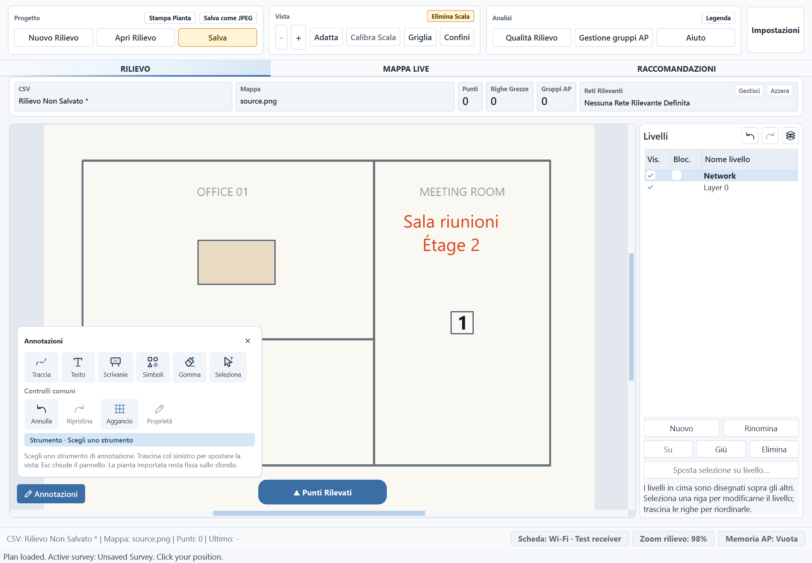
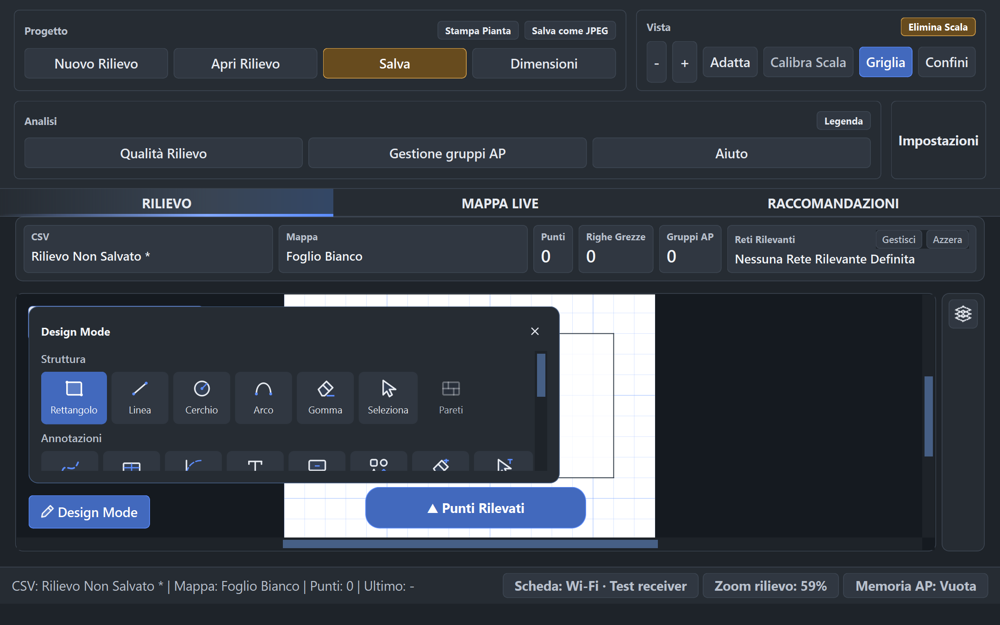

# Audit di controllo — 9 novembre 2026

Controllo successivo all'introduzione di Annotazioni, Livelli e Legenda in
Carica Pianta, sul commit `49a41e4`. L'audit ha individuato difetti riproducibili,
corretti in questo intervento. Porte, finestre e struttura restano escluse dalle
piante importate.

## Difetti risolti

| Area | Problema riprodotto | Comportamento corretto |
| --- | --- | --- |
| Posizione AP | Il posizionamento diretto di un AP già associato a un simbolo veniva ricondotto alle vecchie coordinate del simbolo. | Il click sposta simbolo e AP insieme, conserva il collegamento e produce una sola operazione annullabile. Annulla/Ripeti ripristinano entrambi. |
| Modalità di interazione | Il posizionamento AP lasciava aperti gli strumenti Annotazioni, con stato e anteprime concorrenti. | Avviare il posizionamento chiude Annotazioni e Boundaries. Un click sinistro reale simulato con Qt viene acquisito nel punto corretto. |
| Vincoli dei livelli | Il percorso diretto degli AP richiedeva gli stessi vincoli dell'editor dei simboli. | Un simbolo su un livello nascosto o bloccato non si sposta; un messaggio indica come rendere modificabile il livello. Durante l'acquisizione entrambe le azioni di posizione sono inibite, anche chiamandole direttamente. |
| Integrità della sorgente | Un JPEG esportato poteva sovrascrivere il JPEG importato; la collisione era possibile anche col nome automatico di una pagina di legenda. | Prima di scrivere qualsiasi pagina si controllano tutti i nomi di destinazione contro la sorgente. Una collisione rifiuta l'export senza modificare i file. Il confronto considera percorsi risolti, maiuscole/minuscole Windows e identità del file. |
| Sfondo PDF | La conversione RGB eliminava l'alpha delle zone non dipinte e poteva rendere neri i margini del foglio. | La pagina viene composta sul bianco prima della conversione. Il test verifica margini bianchi e contenuto colorato sia nel percorso Qt sia in quello PIL usato dagli export. |
| Testi UI | Il suggerimento dell'associazione AP citava solo Design Mode. | Indica anche Annotazioni, in tutte e quattro le lingue. Sono tradotti anche i nuovi messaggi di rifiuto. |

Le regressioni iniziali hanno riprodotto i problemi prima delle correzioni.
Il nuovo gruppo `tests/test_loaded_plan_audit.py` copre nove casi indipendenti:
click AP, sincronizzazione e cronologia, due stati di acquisizione, due vincoli
dei livelli, due collisioni JPEG e margini PDF. I test usano file temporanei e
dati sintetici.

## Controlli di integrazione

- Confermata la separazione Carica Pianta / Disegna pianta, anche nei documenti
  vecchi: importazione, calibrazione, strumenti ammessi, rifiuto atomico di
  struttura e aperture su qualsiasi livello, compresi quelli nascosti.
- Ricontrollati livelli visibili/bloccati, trasferimenti, legenda e inventario
  rack, assegnazione AP, cronologia, salvataggio e riapertura. Gli overlay restano
  nei metadati; lo sfondo importato conserva i propri byte.
- Controllati rendering Live Map e HTML, stampa e JPEG con legenda, dimensioni
  della pianta importata e comportamento esistente di Disegna pianta. La suite
  comprende anche persistenza, transazioni dei file, validazione dei dati e
  escaping HTML; non sono state modificate le regole RF.
- Ambiente `.venv315` verificato con l'interprete del progetto: tutte le **31
  dipendenze bloccate** corrispondono alle versioni installate; `pip check` non
  segnala conflitti. [Confronto delle versioni](audit-assets/control-2026-11-09/dependencies.json).
- Controllati sintassi e risorse dichiarate in `WifiHeatmap.spec`. Nessuna nuova
  dipendenza o risorsa esterna necessaria; non è stato costruito un nuovo EXE.
  Il parsing sintattico è passato su **236 file Python** e sullo spec.
  [Risultati statici e packaging](audit-assets/control-2026-11-09/static-results.json).

## Risultati finali

- Suite generale finale: **2.402 test e 479 subtest passati**, 275,71 secondi,
  exit code 0. Nessun abort nel giro finale.
  [Output completo](audit-assets/control-2026-11-09/full-suite.txt),
  [comando ed esito](audit-assets/control-2026-11-09/full-suite-result.json).
- Il test esistente della conferma AP dichiara ora esplicitamente che il rilievo
  simulato non sta acquisendo; le verifiche sulla conferma e sulla sua revoca
  restano invariate. I 38 test mirati di questo gruppo e dei nuovi casi passano.

- **96 configurazioni Carica Pianta passate**: PNG/PDF × EN/IT/FR/ES × quattro
  temi × scale 100/125/175%. Verificati comandi ammessi, assenza di struttura e
  aperture, legenda disponibile, geometria della palette, icone e nomi
  accessibili; i file sorgente conservano i propri byte.
  [Risultati Carica Pianta](audit-assets/control-2026-11-09/ui-loaded-results.json).
- **48 configurazioni Disegna pianta passate**: quattro lingue × quattro temi ×
  tre scale, con strumenti strutturali, annotazioni, scorrimento della palette e
  barra comandi adattiva. [Risultati Disegna pianta](audit-assets/control-2026-11-09/ui-draw-results.json).
- Ispezionati i render nativi di Carica Pianta in italiano/chiaro/125% e Disegna
  pianta in italiano/scuro/175%. Alla scala più alta la palette strutturale
  richiede scorrimento, previsto e verificato dalla campagna UI.





Le scritte inglesi e francesi dentro la pianta sintetica sono contenuto di
prova. Un messaggio di stato già visualizzato può conservare la lingua con cui
era stato generato prima del cambio lingua; le etichette correnti dei comandi
sono state verificate dalla campagna.

### Stabilità dell'acquisizione simulata

**8 esecuzioni isolate su 8 passate**, ciascuna con i 38 test di
`tests/test_guided_capture.py`: **304 test complessivi**, senza abort nativi.
[Risultati e durate](audit-assets/control-2026-11-09/capture/capture-results.json).
Lo script riproducibile è `tools/check_capture_stress.py`; ogni processo ha un
limite di 60 secondi e conserva il proprio output.

L'abort incontrato nel primo giro della precedente consegna non è stato
riprodotto. **La sua causa resta indeterminata**: questi risultati documentano
le prove riuscite, non dimostrano che un problema intermittente sia impossibile.
Non sono state introdotte modifiche speculative ai thread di acquisizione.

I controlli finali non hanno evidenziato altre regressioni riproducibili nel
perimetro esaminato. `git diff --check` è passato.

## Riproduzione e limiti

```powershell
.\.venv315\Scripts\python.exe -m pytest -q --tb=short --show-capture=no
.\.venv315\Scripts\python.exe tools/check_capture_stress.py --output .private/control-audit/capture --repeats 8
.\.venv315\Scripts\python.exe tools/check_loaded_plan_ui.py --output .private/control-audit/ui-loaded
.\.venv315\Scripts\python.exe tools/check_design_ui.py --output .private/control-audit/ui-draw
.\.venv315\Scripts\python.exe -m pip check
```

Verifiche automatizzate su Windows/Qt nativo e ispezione dei render; nessuna
scansione Wi-Fi reale, prova su stampante fisica, sessione manuale completa o
verifica del pacchetto EXE. Il confronto delle dipendenze verifica coerenza e
compatibilità installata, senza interrogare un database di vulnerabilità.
La cartella locale preesistente `test_data/` resta esclusa dalle modifiche e dal
commit.
