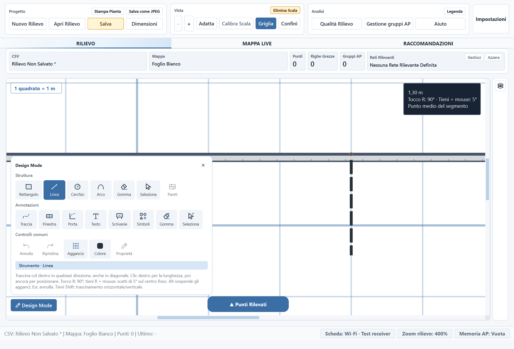

# Segmenti agganciati: lunghezza utile — 9 novembre 2026

La lunghezza numerica indica il tratto utile oltre la parete di aggancio.
Il riferimento agganciato rimane fermo; il tratto nascosto nello spessore viene
aggiunto alla geometria interna, allungando l'estremo libero.

Esempio verificato: **130 cm richiesti + 10 cm coperti = 140 cm di riferimento
interno e 130 cm esposti**. Per un riferimento sull'asse del muro si considera
soltanto la parte effettivamente coperta; per un attacco obliquo si considera
il tratto attraversato nella direzione del segmento.

L'anteprima parte dalla faccia fisica e mostra la lunghezza utile. Anche la
lettura durante il trascinamento, le quote al passaggio del cursore e la
lunghezza dei lati dritti nell'editor pareti usano il tratto utile. Agganci
collineari/condivisi non vengono sommati come ostacoli; due facce dello stesso
muro non raddoppiano la compensazione. I tagli delle aperture sono rispettati.

Alt conserva la posa letterale, senza compensazione. Se una lunghezza numerica
non può essere mantenuta o l'estensione esce dal foglio, la posa è segnalata
come non valida e non modifica il rilievo.

La compensazione riguarda le nuove pose numeriche. I segmenti già salvati
conservano le loro coordinate; le loro quote mostrano la parte utile esistente.
Posa, annullamento, undo/redo e salvataggio mantengono la transazione unica.

Il punto arancione è il riferimento interno; l'anteprima tratteggiata inizia
alla faccia esterna del muro. La misura mostrata è **1,30 m**.

## Verifiche

- Suite completa: **2.490 test e 479 subtest passati**, 278,93 secondi,
  exit code 0. [Output](audit-assets/line-attachment-2026-11-09/full-suite.txt).
- 26 nuovi casi: profili su faccia/asse, direzioni e rotazioni, attacco sullo
  spigolo, facce condivise, aggancio dall'estremo opposto, Alt, trascinamento,
  proprietà e quote, undo/redo, riapertura, aperture e rifiuto delle pose fuori
  foglio o incompatibili con la misura utile.
- **48 configurazioni UI passate**: quattro lingue, quattro temi e scale
  100/125/175%. In ogni caso: 65 px utili, 5 px nascosti, 70 px interni con
  calibrazione 50 px/m. [Risultati](audit-assets/line-attachment-2026-11-09/ui-results.json).
- Parsing dei file Python modificati e `git diff --check` passati.

Le prove usano Qt nativo con disegni sintetici. Non comprendono scansioni RF,
una sessione manuale completa o una nuova build EXE. `test_data/` rimane esclusa
dalle modifiche e dal commit.
