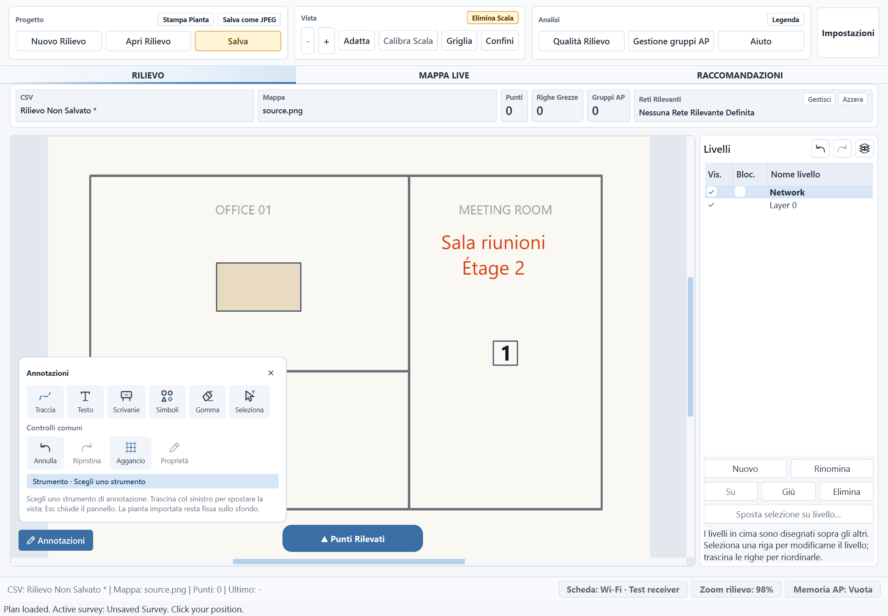
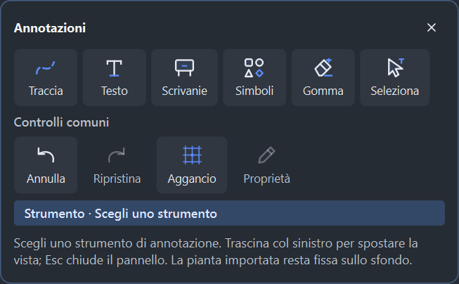
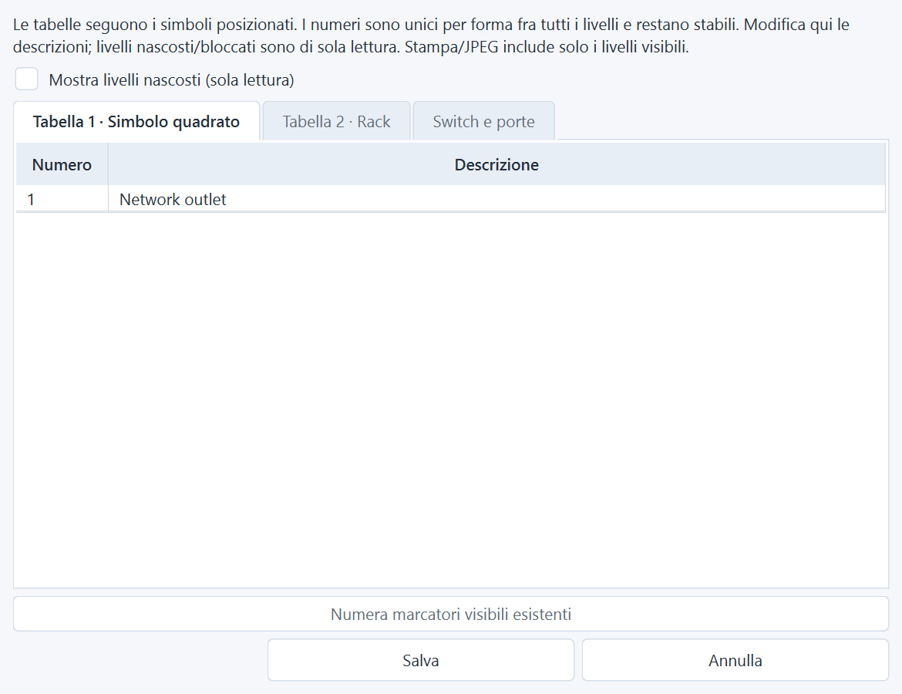

# Load Plan: annotazioni, livelli e legenda

9 novembre 2026 — sorgenti 1.3.0 / Unreleased.

## Comportamento

La scelta iniziale rimane **Disegna pianta / Carica Pianta**. Con Carica Pianta,
l'immagine o il PDF importato resta uno sfondo fisso. Dopo la calibrazione,
**Annotazioni** consente testi, tracce, scrivanie, simboli numerati, rack e simboli
Wi-Fi AP. Struttura, spessori/materiali, porte, finestre, ridimensionamento e
riempimento degli ambienti non sono disponibili in questa modalità.

Prima della calibrazione il pulsante Annotazioni è visibile ma disabilitato e
spiega come abilitarlo. Livelli e Legenda sono accessibili; i livelli si possono
organizzare anche prima di inserire oggetti. I controlli nascosti sono esclusi
anche dalla selezione programmatica dello strumento e dalla validazione dei dati,
compresi i livelli nascosti: non basta importare metadati strutturali per usarli.

I livelli conservano ordinamento, visibilità, blocco e selezione attiva. Testi e
oggetti si possono selezionare, spostare, ruotare, modificare, cancellare e
trasferire fra livelli. Le operazioni e le descrizioni della legenda supportano
annulla/ripristina. La numerazione dei simboli resta stabile fra tutti i livelli.
Rack, switch e descrizioni delle porte sono inclusi nella legenda.

In Gestione gruppi AP, il menu del pulsante di posizionamento permette sia il
posizionamento diretto preesistente sia **Assegna simbolo AP**. L'associazione
collega il simbolo a un AP fisico, preservando coordinate esatte e cronologia.
Disegna pianta conserva il proprio flusso di assegnazione.

## Sorgente, salvataggio ed esportazione

La sorgente originale non viene sovrascritta. Testi, annotazioni, livelli e
legenda vengono salvati nei metadati del rilievo; Carica Pianta non genera un PNG
che incorpori le modifiche. Riaprire il CSV ricompone gli oggetti sopra la stessa
immagine o lo stesso PDF. La sorgente deve quindi restare disponibile, come nel
precedente flusso di importazione.

Stampa, JPEG, Mappa Live e HTML combinano lo sfondo con i livelli visibili.
La stampa/JPEG può includere anche le pagine di legenda e inventario rack.
Gli export della pianta importata mantengono l'intera immagine e le sue
proporzioni. Non viene applicato il ritaglio agli ingombri del disegno usato per
Disegna pianta. Punti di rilievo e marcatori operativi AP restano separati dalle
annotazioni e dalla stampa della pianta pulita.

Sono riconosciuti anche i rilievi importati precedenti, senza `plan_mode`.
Il tipo esplicito Load Plan prevale su eventuali vecchi flag di pianta generata,
così il rendering conserva lo sfondo e non abilita la struttura.

## Anteprime

Carica Pianta, tema chiaro, con palette Annotazioni e Livelli:



Palette nel tema scuro:



Legenda dei simboli, con schede Rack e Switch e porte:



Le immagini sono render di widget Qt reali su una pianta sintetica; le linee e
le scritte inglesi grigie appartengono allo sfondo importato, non all'editor.

## Verifica e limiti

- Suite completa finale su Windows/Qt nativo: **2.393 test e 479 subtest passati**,
  186,22 s. `git diff --check` e controllo sintattico dei file Python passati.
- **96 configurazioni UI passate**: PNG/PDF × EN/IT/FR/ES × quattro temi ×
  100/125/175%. Verificati apertura, selezione, esclusione di struttura e aperture,
  etichette e nomi accessibili, contenimento della palette e legenda disponibile.
  I byte dei file sorgente restano invariati. [Risultati JSON](audit-assets/loaded-plan-2026-11-09/ui-results.json).
- Test di integrazione per inserimento/spostamento/cancellazione e cronologia,
  trasferimento fra livelli, visibilità/blocco, descrizioni della legenda,
  inventario rack, sorgenti PNG/PDF, riapertura e compatibilità dei rilievi vecchi.
- Verificati rigetto atomico della struttura anche su livelli nascosti, assenza
  di acquisizioni RF durante Annotazioni, conservazione dello sfondo nel worker
  Live Map e nell'immagine incorporata nell'HTML, JPEG reale e PDF di stampa con
  pagine di legenda. Le prove usano dati sintetici; non avviano scansioni Wi-Fi.
- Il primo giro generale ha incontrato un abort nativo durante un test di
  acquisizione simulata. I 38 test del gruppo passano isolatamente e l'abort non
  si è ripetuto nei due giri generali successivi. Il penultimo giro aveva una
  vecchia aspettativa sulla legenda di Load Plan, aggiornata al comportamento
  richiesto; il giro finale è interamente passato. La causa dell'abort iniziale
  non è stata determinata.

Riproduzione della campagna visiva:

```powershell
.\.venv315\Scripts\python.exe tools/check_loaded_plan_ui.py --output docs/audit-assets/loaded-plan-2026-11-09
```

Le verifiche sono automatizzate su Qt nativo e accompagnate dall'ispezione dei
render. Non comprendono una sessione manuale completa col mouse, una stampante
fisica, nuovi rilievi sul campo o un pacchetto EXE. La cartella locale preesistente
`test_data/` resta fuori dall'intervento e dal commit.
