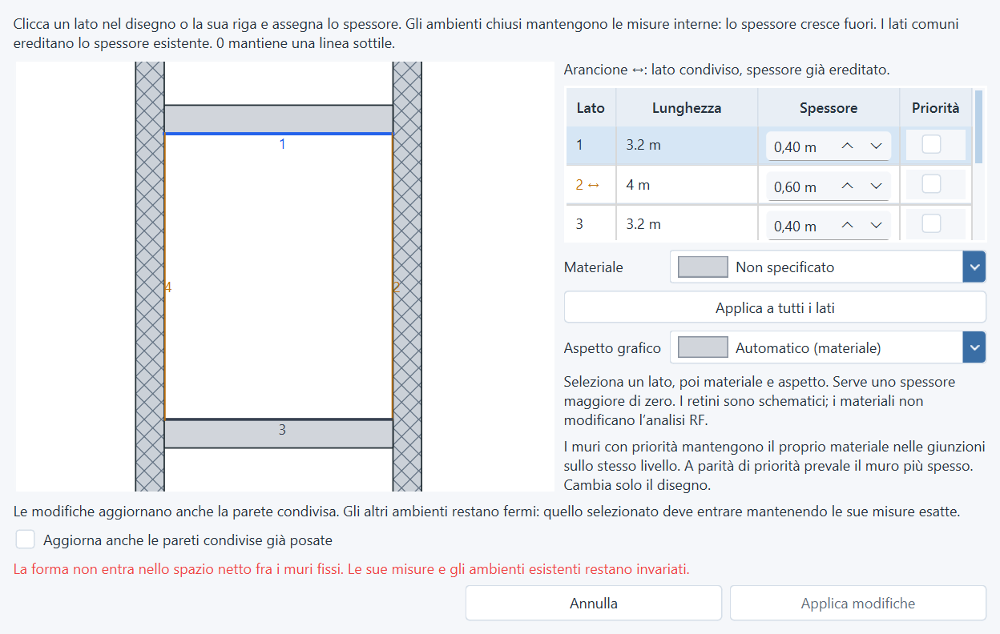

# Posa fra due pareti parallele — 2026-11-10

La posa e lo spostamento conservano le **misure esatte** della forma. Le stanze
vicine restano ferme. Una forma troppo grande per lo spazio netto viene rifiutata;
non viene ristretta automaticamente.

## Spazio netto e riferimenti

L'aggancio deve considerare le facce fisiche dei muri, oltre ai segmenti di
riferimento. Per esempio, con 200 cm fra i due riferimenti e due spessori di
20 cm rivolti verso lo spazio libero, la misura disponibile è **160 cm**.
Una forma larga 160 cm può entrare; una larga 180 o 200 cm non può entrare
mantenendo sia le proprie dimensioni sia le posizioni delle stanze vicine.

La posa diretta usava già vincoli rigidi sulle pareti esistenti. Lo spostamento
passava invece dalla semplice unione dei segmenti: poteva lasciare la forma sui
riferimenti interni, senza ereditare correttamente i profili dei muri condivisi.
La successiva modifica degli spessori ancorava l'ambiente selezionato e poteva
spostare quelli adiacenti per risolvere il conflitto.

## Comportamento corretto

- Una stanza chiusa indipendente, spostata vicino a muri con spessore, usa lo
  stesso aggancio alle facce fisiche della posa diretta. La traslazione mantiene
  dimensioni, contenuti e aperture, senza modificare gli ambienti già presenti.
- L'anteprima di spostamento mostra l'appoggio sulla faccia del muro. Se i due
  appoggi richiedono traslazioni incompatibili, la sagoma diventa rossa.
- Le facce condivise ereditano il profilo esistente anche quando il rettangolo
  spostato aveva già uno spessore o un materiale diverso.
- Modificando gli spessori di un solo ambiente, gli altri ambienti sono fissi.
  Una richiesta incompatibile disabilita l'applicazione e spiega che la forma
  non entra nello spazio netto. Una richiesta compatibile può traslare soltanto
  l'ambiente selezionato, conservandone le dimensioni.
- Le selezioni parziali e la modifica simultanea di più ambienti mantengono il
  loro percorso di editing. Nessun formato di salvataggio cambia.

## Verifiche

**20 nuove regressioni** su rettangoli fra due stanze, spessori uguali e diversi,
rotazioni 0°/35°/90°/180°, forma della misura netta corretta, forme più larghe,
posa diretta e relativa revisione, annullamento, spostamento con testi e aperture,
anteprima valida/non valida, modifiche degli spessori compatibili e incompatibili,
transazione unica, undo/redo e salvataggio/riapertura.

- Suite completa: **2.669 test e 479 subtest passati**, exit code 0,
  360,23 secondi. [Output](audit-assets/parallel-walls-2026-11-10/full-suite.txt).
- Verifica finale dopo il ritocco alla selezione e ai messaggi della revisione:
  **66 test passati**. [Output](audit-assets/parallel-walls-2026-11-10/final-targeted.txt).
- **16 configurazioni UI** con Qt nativo: quattro lingue, due temi e scale
  100%/175%. Verificati messaggio leggibile, limiti dello schermo, proposta
  incompatibile non applicabile e nessuna modifica al progetto dalla revisione.
  [Risultati](audit-assets/parallel-walls-2026-11-10/ui-results.json).
- Parsing Python, Ruff sui file interessati con esclusione delle convenzioni
  preesistenti `E741/F401/F811`, e `git diff --check` passati.
- Hash SHA-256 dei quattro file originali in `test_data/` invariati.

Le prove e l'immagine sono sintetiche. I dati originali in `test_data/` restano
fuori dal commit. Versione 1.4.0 invariata; nessuna nuova build EXE.
