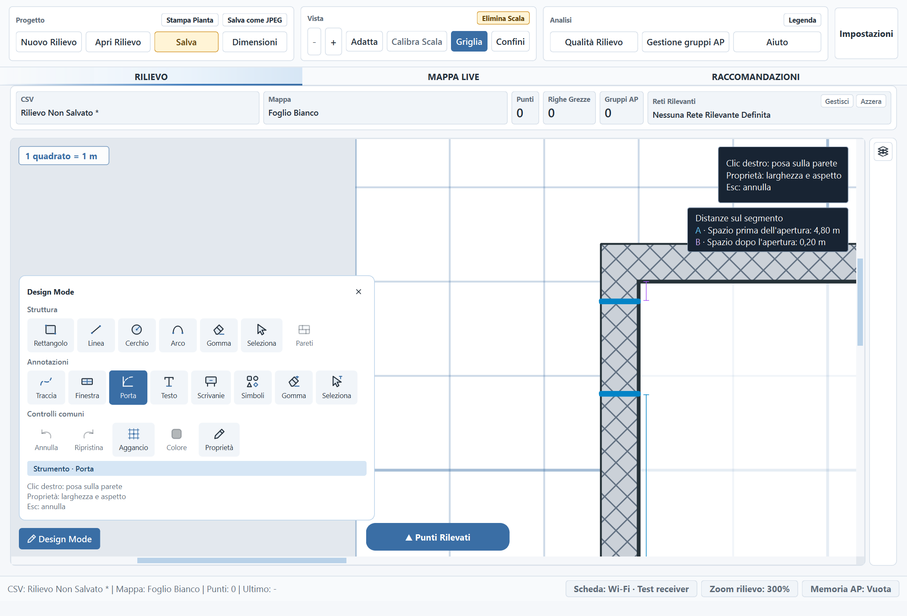
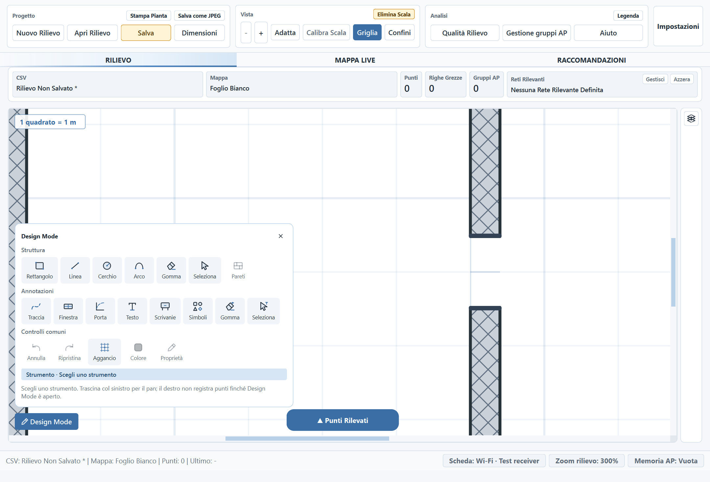

# Porte e finestre su muri con spessore — 9 novembre 2026

I telai si adattano all'intero spessore fisico della parete e risultano centrati
fra le sue facce. Vale anche per i muri condivisi: scegliere una faccia o quella
opposta produce lo stesso telaio. La posa accetta il puntatore nel corpo del
muro, oltre che vicino alla linea di riferimento.

Durante posa e spostamento di una singola porta/finestra, le quote A/B mostrano
soltanto le due distanze libere: dall'inizio del segmento al primo stipite e dal
secondo stipite alla fine del segmento. Anche le linee di quota terminano ai
rispettivi stipiti. La posizione del cursore attraverso lo spessore non entra
nelle misure.

Le quote rispettano gli estremi del segmento che contiene l'apertura, incluse
le giunzioni degli ambienti. Se l'apertura attraversa un taglio di normalizzazione,
si ricompone il tratto di supporto continuo; non si attraversano veri vuoti.
Per gli altri strumenti restano le precedenti quote riferite al cursore.

## Compatibilità e rendering

Lo spessore del telaio viene ricavato dai muri, senza aggiungere campi ai rilievi
o spostare le coordinate salvate delle aperture. Le aperture già presenti si
adattano anche quando cambia lo spessore della parete; larghezza e riferimento
di supporto restano conservati. I muri senza spessore mantengono la resa
schematica precedente.

Sono aggiornati telaio semplice, finestra, scorrevole e porte a una/due ante,
con gli archi centrati sul profilo fisico. Anteprima, disegno confermato,
selezione, spostamento/rotazione dei gruppi e renderer vettoriale condividono la
geometria adattata. Stampa/JPEG, rendering a livelli e Live/HTML usano lo stesso
percorso. Topologia dei locali, comportamento dei tagli e regole RF restano
separati dalla rappresentazione del telaio.

## Anteprime native Qt

Posa a **0,20 m** dall'angolo, con due sole quote riferite agli estremi della porta:



Porta con solo telaio già confermata sul muro condiviso; gli stipiti coprono
entrambe le facce:



La posa è mostrata al 300% per distinguere il bordo del telaio e ridurre la
quantizzazione del puntatore. Durante l'anteprima il tratteggio del muro resta
visibile; il taglio viene applicato alla conferma.

## Verifiche

- Suite completa: **2.464 test e 479 subtest passati**, 312,82 s, exit code 0.
  [Output](audit-assets/thick-openings-2026-11-09/full-suite.txt),
  [esito](audit-assets/thick-openings-2026-11-09/full-suite-result.json).
- 55 nuovi casi: varianti, tre orientamenti, profili su faccia/asse e lati
  invertiti, pareti condivise, posa nel corpo del muro, 20 cm sul muro verticale,
  normalizzazione e giunzioni, profondità dei telai, raster/vettori,
  undo/redo e riapertura senza riscrivere le aperture.
- **96 configurazioni UI passate**: porta/finestra × quattro lingue × quattro
  temi × 100/125/175%. Verificati presenza delle due quote, assenza delle quote
  del cursore, centratura e profondità del telaio e contenimento del riquadro misure.
  [Risultati](audit-assets/thick-openings-2026-11-09/ui-results.json).
- Testo di aiuto finale ricontrollato nelle quattro lingue: **13 test e 434
  subtest passati**. [Output](audit-assets/thick-openings-2026-11-09/i18n.txt).
- Parsing dei file Python modificati e `git diff --check` passati.

Riproduzione delle anteprime e della campagna UI:

```powershell
.\.venv315\Scripts\python.exe tools/check_opening_ui.py --output .private/thick-opening-ui
```

Le prove sono automatizzate su Qt nativo con disegni sintetici; non comprendono
una sessione manuale completa, una stampante fisica o un nuovo pacchetto EXE.
La cartella locale preesistente `test_data/` resta esclusa dal commit.
