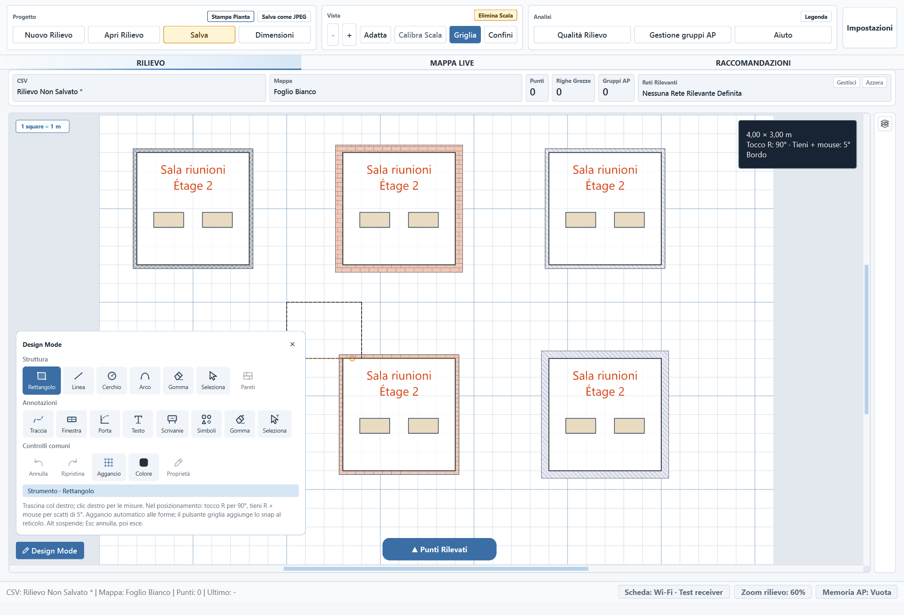

# Audit di unioni, split e prestazioni — 2026-11-10

Verifiche conclusive completate l'11 novembre 2026.

## Difetti riprodotti e corretti

**Split che comparivano alla modifica successiva.** I tagli di una faccia
parallela venivano applicati soltanto al profilo che li aveva introdotti. Un
altro segmento sovrapposto, con spessore o materiale diverso, rimaneva intero:
alla successiva normalizzazione si divideva ancora. Il difetto si riproduce
con tre segmenti. Ora i tagli vengono propagati a tutti i profili coincidenti
nella stessa operazione, anche quando ci sono curve.

**Tratti allineati che non si riunivano.** La compatibilità usava componenti
arrotondate della normale del muro. Due parti della stessa retta potevano
cadere ai lati di una soglia di arrotondamento e restare separate. Il confronto
ora verifica i profili e la direzione fisica senza usare quella quantizzazione
come criterio di compatibilità. Profili effettivamente diversi restano distinti.

**Opacità della griglia durante il pan accelerato.** La cattura della finestra
composta ha mostrato una riga intera che passava dall'alpha normale a quello
attenuato. I tratti ora usano colori con alpha già preparato, evitando cambi
ripetuti dello stato di opacità del painter.

Gestita anche la proiezione su un frammento collassato, che deve restituire
l'estremo finito anziché dividere per zero.

## Percorso di rendering e lavoro eliminato

- Il canvas seleziona un viewport OpenGL se la creazione del contesto riesce
  e il renderer rilevato è hardware. Mantiene il percorso software su sistemi
  headless, contesti non disponibili o emulatori GL riconosciuti.
- Il viewport accelerato usa aggiornamenti completi e un formato con
  multisampling/stencil. Richiede swap senza sincronizzazione; il driver può
  negoziare un valore diverso.
  È il percorso previsto da [Qt QGraphicsView](https://doc.qt.io/qt-6/qgraphicsview.html)
  e [QOpenGLWidget](https://doc.qt.io/qt-6/qopenglwidget.html).
- Non viene reintrodotta la cache dei materiali in coordinate del dispositivo.
  Contorni, aperture e geometria modificabile restano vettoriali. I materiali
  restano descrittivi, senza introdurre attenuazioni RF.
- Le relazioni fra facce usano un indice spaziale conservativo, seguito dallo
  stesso controllo geometrico esatto. Non vengono confrontate tutte le pareti
  con tutte le altre durante split, cleanup e cancellazioni.
- La topologia delle stanze è immutabile e riutilizzabile: cache di massimo otto
  geometrie, limitata anche dal numero di punti/primitivi, con accesso protetto
  fra thread. La chiave include coordinate, profili, ordine e modalità dei confini.
- Una maschera della griglia invariata non viene ricostruita. Nei progetti a
  livelli viene aggiornato direttamente il risultato dei livelli visibili.
- Misure e guide identiche riusano layout e oggetti grafici. Il pannello delle
  misure non azzera e ripristina la larghezza a ogni movimento del mouse.
- La conferma della revisione dei muri riusa la proposta già validata. Prima di
  accettare interpreta gli eventuali spessori ancora digitati: se cambiano,
  i segnali dei campi ricostruiscono e validano la proposta. I controlli su
  progetto modificato durante la modale e vincoli del rilievo restano attivi.
- Nella sola vista d'insieme vengono omessi i tratteggi con passo inferiore a
  quattro pixel logici. Zoom e output vettoriali conservano il dettaglio completo.

Per diagnosticare un problema del driver si può avviare con
`WIFI_HEATMAP_RENDERER=software`; la modalità normale è `auto`.

## Metodo di misura

Il progetto fornito viene copiato in una cartella temporanea, con impostazioni
e memoria AP isolate. Gli originali non vengono salvati o modificati. Il
confronto precedente ripristina in memoria le implementazioni del commit
`1e63e14`, senza cambiare i file di lavoro.

Le misure definitive usano una finestra esposta e contano gli eventi di paint:
ogni sequenza di pan deve aver effettivamente ridisegnato almeno otto frame.
Sono mediane di cinque esecuzioni, senza profiler e senza altri test concorrenti.
La macchina di prova usa la GPU integrata AMD Radeon 610M, Qt 6.12/PySide6,
Windows e DPR 1,5; il progetto contiene 93 segmenti, 19 testi e 6 annotazioni.
L'applicazione è già avviata quando si misura l'apertura del progetto. Le
decisioni del dialogo sono automatizzate, senza includere il tempo dell'utente.

La normale cattura `QWidget.grab()`/`QOpenGLWidget.grabFramebuffer()` non è una
prova sufficiente per questo viewport: può richiamare il `paintGL()` predefinito
e catturare un buffer azzerato. I confronti finali leggono la finestra composta,
verificano che siano presenti pixel reali dei materiali e poi confrontano il
pan con un ridisegno completo. Le prime misure nascoste sono state scartate.

## Risultati sul progetto fornito

Tempi in millisecondi, confrontati con `1e63e14`. Pan, passaggio del puntatore e
anteprima comprendono **otto movimenti**; le letture comprendono cinque gruppi.

| Operazione | Prima | Dopo | Osservazione |
| --- | ---: | ---: | --- |
| Pan | 637,2 | 195,9 | 3,25 volte più rapido; 8 paint in entrambe le versioni |
| Puntatore senza forma da piazzare | 108,9 | 46,1 | 2,36 volte più rapido |
| Anteprima rettangolo | 160,8 | 203,9 | Ancora più lenta del software precedente |
| Inserimento con conferma | 1.273,9 | 625,0 | 2,04 volte più rapido |
| Revisione annullata | 470,3 | 291,5 | 1,61 volte più rapida |
| Apertura progetto | 302,5 | 293,9 | Differenza piccola |
| Letture del disegno | 22,5 | 23,7 | Differenza piccola |

L'anteprima genera una mediana di 7 paint contro gli 8 precedenti. Il tempo
complessivo rimane peggiore di circa il 27%: il repaint completo OpenGL ha un
costo quando cambia solo una piccola forma. Questo punto **non è risolto** e
non viene nascosto nel risultato del pan. Non è stata adottata una cache raster
dei muri, che reintrodurrebbe i difetti di navigazione già riprodotti.

## Scena sintetica più grande

Stesso codice attuale, confrontando renderer software e OpenGL. Mediana e
95° percentile sono misurati su 40 aggiornamenti dopo 5 aggiornamenti di
riscaldamento; ogni caso registra 45 paint reali.

| Ambienti / muri / oggetti | Vista | Mediana software → GPU | 95° percentile GPU |
| --- | --- | ---: | ---: |
| 25 / 100 / 50 | Ravvicinata | 45,1 → 17,9 ms | 22,0 ms |
| 100 / 400 / 200 | Ravvicinata | 52,9 → 19,3 ms | 23,3 ms |
| 400 / 1.600 / 800 | Ravvicinata | 48,1 → 18,6 ms | 23,3 ms |
| 25 / 100 / 50 | D'insieme | 55,6 → 16,9 ms | 20,8 ms |
| 100 / 400 / 200 | D'insieme | 48,0 → 19,0 ms | 26,6 ms |
| 400 / 1.600 / 800 | D'insieme | 89,1 → 29,4 ms | 38,7 ms |

## Controlli di correttezza

- 10.000 grafi sintetici: normalizzazione ripetuta stabile, assenza di profili
  fisici identici duplicati, provenienza dei frammenti valida e indipendenza
  dall'ordine dei segmenti.
- Regressioni per soglie di arrotondamento, indice spaziale confrontato con la
  ricerca esaustiva, facce quasi parallele, attacco/cancellazione ripetuti,
  materiali diversi e priorità. Restano i test di curve, aperture, undo/redo,
  persistenza e inserimento esatto fra due muri con stanze vicine ferme.
- Il progetto fornito resta stabile per 20 normalizzazioni consecutive; nessun
  profilo identico duplicato nella rappresentazione normalizzata. Tutti i file
  originali, incluso il PNG, mantengono lo stesso SHA-256.
- 108 confronti nativi su GPU: 3 geometrie × 3 pattern × 3 zoom × 4 DPR
  **effettivi** (1 / 1,25 / 1,5 / 2). Ogni cattura contiene fra 12.793 e 239.177
  pixel dei materiali; il pan e il ridisegno completo coincidono esattamente.
  Il controllo con la vecchia cache produce invece 115.835 componenti diverse
  a DPR 1,5, confermando che il confronto rileva il difetto.
- Nel test integrato del canvas con griglia si ammette soltanto la tolleranza
  di antialiasing di 1/255 su massimo 16 componenti; i confronti sintetici dei
  materiali richiedono zero differenze.
- 48 configurazioni del dialogo: 4 lingue × 4 temi × 3 scale UI. Verificati
  anteprima, conferma del muro condiviso, controlli visibili e nessuna modifica
  alla stanza già esistente prima dell'applicazione.
- Suite completa hardware: 2.831 test e 479 subtest passati. La successiva
  ottimizzazione della conferma è passata in 157 test hardware, inclusi i nuovi
  casi di testo non ancora confermato e spessore fuori dal foglio.
- Fallback software: coperti tutti i 2.834 casi raccolti. L'esecuzione è stata
  interrotta dopo 2.428 test passati ed è ripresa dal confine dei file: ultimi
  496 test e 27 subtest passati, con 90 casi ripetuti per coprire il punto di
  interruzione. Il totale dei subtest della prima tranche non viene ricostruito.
- Ruff sui file toccati e `git diff --check`; le esclusioni Ruff riguardano
  convenzioni/preesistenze del repository. Verificati hook PyInstaller e
  librerie installate `QtOpenGLWidgets`/`QtOpenGL`; nessun EXE ricostruito.

I dati numerici pubblicati non contengono coordinate o contenuti del progetto
reale: [audit-results.json](audit-assets/topology-performance-2026-11-10/audit-results.json).

## Limiti della misura

Il benchmark sintetico separa rendering e preparazione completa della scena.
La scena più grande ha 400 ambienti, 1.600 segmenti e 800 oggetti su un foglio
vettoriale da 8.300 × 8.300 unità. Sono misurate sia una vista ravvicinata, con
culling degli oggetti fuori schermo, sia una vista d'insieme con la maggior parte
degli oggetti visibile. Non è un benchmark del solver di editing su 400 stanze.

La preparazione completa della scena da 400 ambienti costa ancora circa
5,1–5,5 secondi, compresa la griglia. Serve ulteriore lavoro sugli aggiornamenti
incrementali; l'accelerazione del painter non elimina questi calcoli CPU.
Questi tempi descrivono il lavoro del ciclo Qt, non una garanzia sugli FPS
presentati dal monitor o una misura comparativa di Draw.io.

Immagine sintetica; nessuna geometria del progetto reale aggiunta al repository.
Versione 1.4.0 invariata, modifiche sotto Unreleased. Nessuna nuova build EXE.
