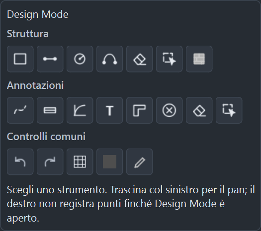
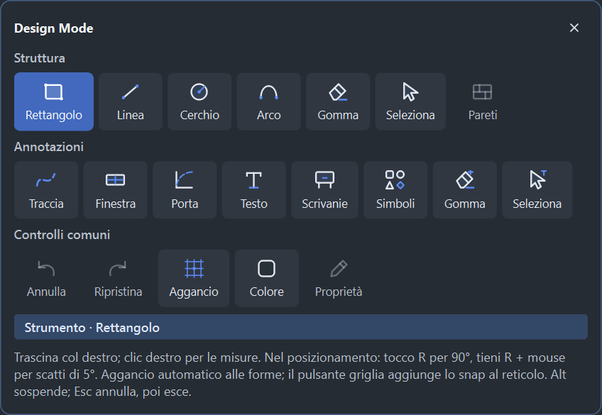
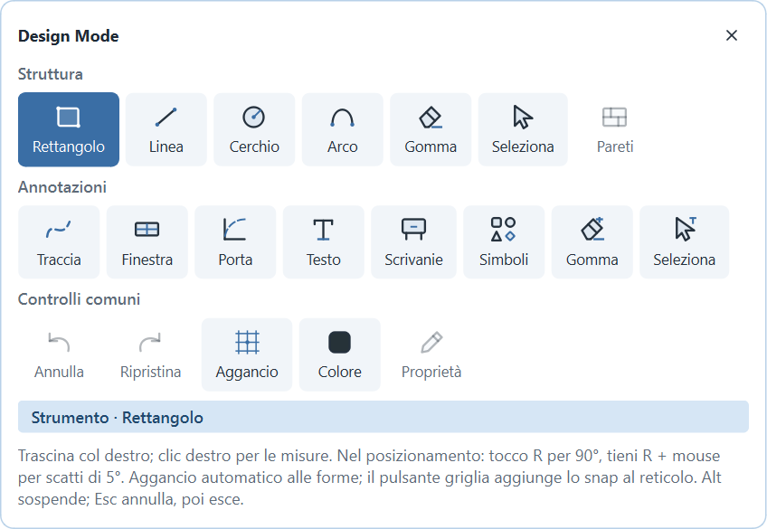
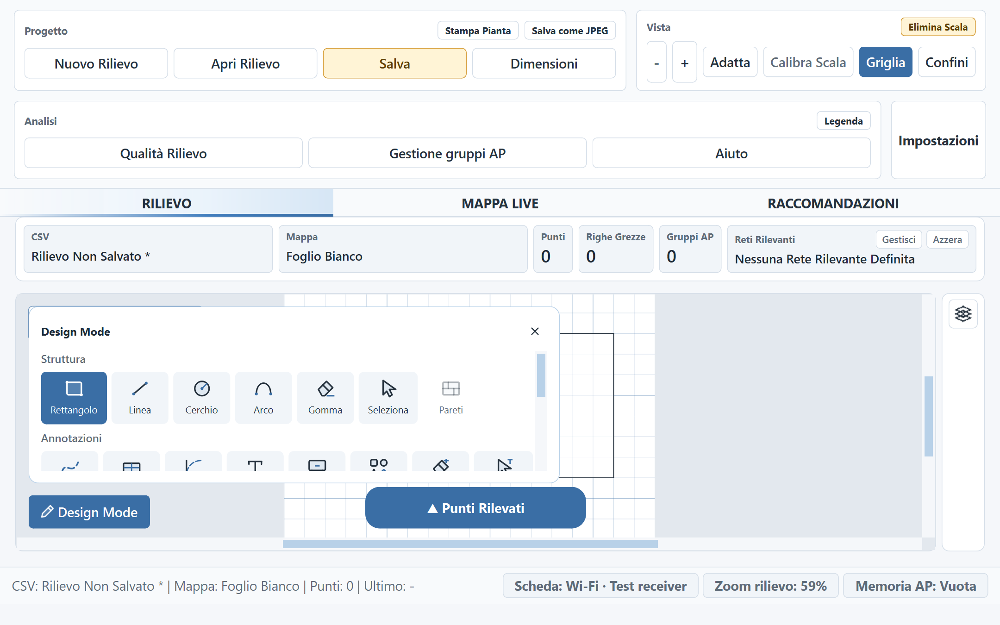

# Audit grafica e usabilità — 9 novembre 2026

Applicazione desktop PySide6, sorgenti 1.3.0 con modifiche Unreleased.
L'avvio rimane `main.py`; gli interventi sono nei componenti `qt_ui/`.

## Valutazione e interventi

La separazione Rilievo / Mappa Live / Raccomandazioni è chiara e la barra distingue
già progetto, vista e analisi. Il punto più debole era Design Mode: icone piccole
con proporzioni diverse, due selettori e due gomme indistinguibili a prima vista,
comandi comprensibili soprattutto tramite tooltip, tipografia poco coerente.

| Problema | Intervento applicato |
| --- | --- |
| Icone poco uniformi e rasterizzate senza la densità reale dello schermo | Famiglia vettoriale comune: tratti arrotondati, proporzioni coerenti, piccoli accenti cromatici e rendering alla densità effettiva. Stati normale, selezionato e disabilitato espliciti. |
| Riconoscimento affidato ai tooltip | Etichette brevi sempre visibili, quattro lingue, gruppi Struttura / Annotazioni / Controlli comuni. Le due gomme e selezioni conservano nomi accessibili completi e ambiti distinti. |
| Modalità corrente poco evidente | Indicazione testuale dello strumento attivo, evidenza del pulsante, istruzioni contestuali e chiusura diretta nel titolo. Apertura neutra e comportamento Esc conservati. |
| Testo bianco su accenti troppo chiari nei temi scuri | Accento dedicato ai controlli pieni, con contrasto testo bianco di almeno 4,5:1 nei quattro temi. Gli accenti delle metriche restano distinti. |
| Palette troppo alta su finestre basse / scala elevata | Contenuto scorrevole con intestazione e chiusura sempre disponibili. Le righe ricalcolano gli ingombri dopo cambi lingua/tema. |
| Pulsanti della barra superiore tagliati a scala elevata | Larghezze basate sulle etichette; disposizione automatica su due righe quando la singola riga non basta. La singola riga torna allargando la finestra. |
| Fondo grigio fisso, indipendente dal tema | Fondo della pianta e della Mappa Live coordinato con la palette dell'applicazione. |
| Quote degli oggetti sovrapposte quando il pannello occupa le posizioni vicine | Ricerca di posizioni libere anche lungo i bordi degli ostacoli, evitando pannelli, oggetti e altre quote. Distanze e dati del disegno invariati. |
| Comandi italiani lasciati in inglese | Fit → Adatta; Resize → Dimensioni. |

Il codice delle icone è riutilizzato per annulla/ripristina; il pannello Livelli
aggiorna le proprie icone anche cambiando tema. I controlli della palette hanno
indicatori di focus da tastiera. Nessuna dipendenza aggiunta.

## Anteprime native

Prima, tema scuro:



Dopo, tema scuro:



Dopo, tema chiaro:



Scala elevata: la barra si dispone su due righe e la palette scorre verticalmente.



Sono render di veri widget Qt, prodotti con impostazioni isolate e un disegno
sintetico; non sono mockup. Le immagini prima/dopo illustrano stati e dimensioni
di finestra differenti, quindi non sono una comparazione pixel per pixel.

## Verifica

- Suite generale su Windows/Qt nativo: **2.375 test e 479 subtest passati**, 284,27 s.
- Campagna UI: **48 combinazioni passate** — EN/IT/FR/ES × Light/Soft/Dark/Contrast
  × 100/125/175%. Dieci stati di strumento per combinazione; verificati apertura
  effettiva, selezione, icone, nomi accessibili, larghezze delle etichette,
  contenimento nel viewport, testo delle istruzioni e barra superiore.
- Sul display usato, 125% è la densità neutra: i moltiplicatori effettivi sono
  0,8 / 1,0 / 1,4. Sono registrati nel [risultato JSON](audit-assets/ui-2026-11-09/ui-results.json).
- Regressioni mirate: annullamento di una forma pendente tramite chiusura,
  raggiungibilità con scorrimento, geometria stabile, lingua/tema senza perdita
  dello strumento, icone a densità 1/1,5/2, contrasto e ritorno della barra alla
  singola riga. I test esistenti verificano anche quote brevi, selezione,
  salvataggi, esportazione e separazione dalle misure RF.
- Verifica mirata finale: **49 test passati** per palette e strumenti curvi;
  **45 test passati** per distanze e quote. Verificato anche il fondo del pulsante
  selezionato in hover nei quattro temi, tramite rendering e stato Qt.
- Il test di memoria delle dimensioni degli archi usa una tolleranza assoluta
  di `1e-9` dopo la conversione fra coordinate di pianta e viewport: una
  differenza di arrotondamento come `160.00000000000006` non è una variazione
  della lunghezza richiesta. Il modello geometrico non è stato modificato.

Comando riproducibile per la campagna UI:

```powershell
.\.venv315\Scripts\python.exe tools/check_design_ui.py --output docs/audit-assets/ui-2026-11-09
```

## Limiti e compromessi

Le etichette rendono la palette più larga della precedente: è una scelta a favore
del riconoscimento immediato. Sulle finestre basse i comandi inferiori si
raggiungono scorrendo; il trascinamento sinistro continua a spostare la pianta.
Le istruzioni complete restano disponibili, comprese le scorciatoie per gli
strumenti più avanzati.

Sono stati esaminati il launcher, il workspace di rilievo, Design Mode e gli stati
senza misure di Mappa Live / Raccomandazioni. Le prove sono native Qt automatizzate
e ispezione dei render: non costituiscono uno studio di usabilità con utenti,
una sessione manuale completa col mouse, nuove scansioni RF o verifica dell'EXE
confezionato. I dati locali in `test_data/`, preesistenti e non tracciati,
non sono stati modificati.
