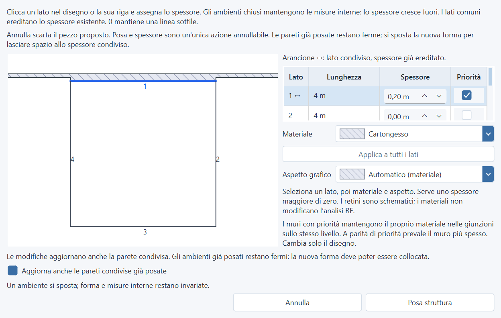

# Pan e posa su pareti esistenti — 2026-11-10

## Tratteggi durante il pan

La cache in coordinate del dispositivo lasciava strisce sfalsate quando il pan
aggiornava soltanto una parte del muro, soprattutto con densità frazionarie.
I materiali ora ridisegnano direttamente i vettori già calcolati. Riempimenti,
tratteggi e contorni mantengono la stessa posizione senza cambiare il modello.

La prova controllata riproduce il difetto riattivando soltanto la vecchia cache:
[immagine con cache](audit-assets/wall-navigation-2026-11-10/cached-pan.png) ·
[ridisegno vettoriale](audit-assets/wall-navigation-2026-11-10/vector-pan.png).

## Nuova forma e muro comune

Una nuova stanza chiusa contro una parete aperta poteva ribaltare lo spessore
del tratto condiviso. Ora il riferimento esistente resta fermo e la nuova forma
si appoggia alla faccia fisica esterna, mantenendo le sue dimensioni interne.
Funziona anche chiudendo tre lati contro una parete già posata o quando il muro
ha già entrambe le facce di riferimento.

Durante la posa, gli ambienti esistenti sono vincolati alla posizione originale.
Testi e annotazioni libere restano fermi; le aperture mantengono un supporto
valido anche quando una variazione di spessore cambia la faccia esterna.
Se la forma non può entrare tra i supporti fissi o supera il foglio, la modifica
viene rifiutata senza alterare il progetto.

L'anteprima usa le posizioni risultanti, compresi gli ulteriori adattamenti quando
si cambia uno spessore. Nell'esempio è proposta una parete condivisa da **20 cm**:
la nuova forma si adegua, mentre il riferimento della parete posata resta fermo.

La posa, la conferma delle modifiche condivise, annullamento, undo/redo e
salvataggio conservano la transazione unica. L'editing ordinario di un layout
esistente mantiene le sue regole di ancoraggio. I profili esplicitamente convertiti
su asse/faccia conservano il contratto precedente e non vengono riconvertiti.

## Verifiche

- Suite completa: **2.637 test e 479 subtest passati**, exit code 0,
  394,60 secondi. [Output](audit-assets/wall-navigation-2026-11-10/full-suite.txt).
- **55 nuovi casi** su pan e pan inverso, zoom frazionario, curve, muri ruotati,
  aperture, geometria e cronologia invarianti, posa su entrambi i lati del muro,
  riferimenti doppi, chiusura con tre lati, conflitti, limiti del foglio,
  anteprima, annullamento e riapertura.
- **108 confronti grafici** dopo il pan: zero componenti di colore differenti
  rispetto a un ridisegno completo alla stessa posizione. Densità effettive
  verificate: **1,25 / 1,5 / 2**; la richiesta di scala 1 usa il DPR nativo 1,5
  su questa macchina. La vecchia cache riproduce differenze nelle prove di controllo.
- **48 configurazioni UI**: quattro lingue, quattro temi, scale 100/125/175%.
  Verificate posizione della nuova faccia, riferimento originale invariato,
  ulteriore variazione di spessore, conferma condivisa, limiti dello schermo e
  assenza di modifiche al rilievo prima dell'applicazione.
  [Dati delle prove grafiche e UI](audit-assets/wall-navigation-2026-11-10/results.json).
- Il ritocco finale alle larghezze delle colonne è stato verificato separatamente
  con **65 test passati** e una nuova esecuzione delle **48 configurazioni UI**.
  [Output mirato](audit-assets/wall-navigation-2026-11-10/final-layout-tests.txt).
- Parsing Python, Ruff sui file interessati con esclusione delle convenzioni
  preesistenti `E741/F401/F811`, e `git diff --check` passati.

Prove sintetiche con Qt nativo; nessuna scansione RF, modifica a rilievi reali
o nuova build EXE. Versione 1.4.0 invariata, modifiche sotto Unreleased.
`test_data/` è rimasta esclusa dalle modifiche e dal commit.
