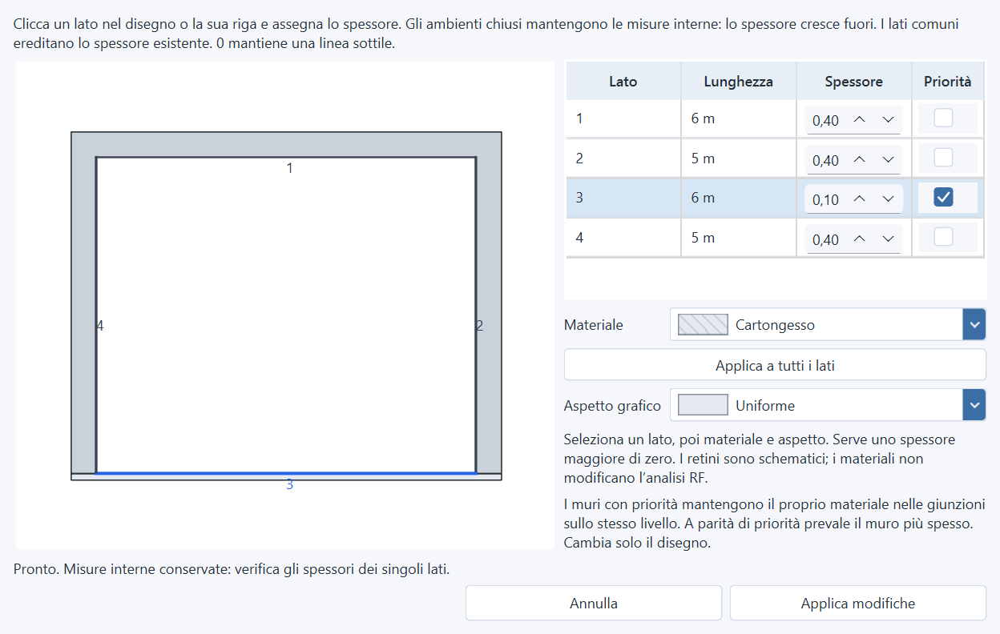

# Priorità dei muri e raccordi agli angoli — 2026-11-09

La tabella di Wall Edit ora include **Priorità**, con una spunta per ogni lato
di spessore positivo. Il muro prioritario mantiene il proprio materiale nelle
sovrapposizioni agli angoli sullo stesso livello. A parità di priorità prevale
il muro più spesso; a parità anche di spessore lo spareggio è stabile e non
dipende dall'ordine di disegno. L'ordine dei livelli resta quello impostato.

La regola vale per riempimenti, tratteggi e contorni: una linea del muro
subordinato non attraversa il materiale vincente. Anteprima, editor, Live Map,
HTML, stampa e JPEG usano la stessa geometria, comprese le curve e le aperture.
Le due facce di un muro condiviso mantengono la stessa priorità. La modifica è
visiva: non cambia misure, coordinate RF o coefficienti dei materiali.

La spunta è leggibile nei quattro temi e seleziona la relativa riga. Senza
spessore il controllo è disabilitato. **Applica modifiche** salva insieme
spessore, materiale, aspetto e priorità; annullamento, conferma dei muri
condivisi, undo/redo e riapertura conservano il comportamento transazionale.
I file precedenti assumono priorità disattivata.

## Angolini separati

Una stanza agganciata al bordo esterno di un muro poteva produrre un breve
frammento autonomo, già coperto dal raccordo della parete esistente. Ora quel
frammento viene ricongiunto al lato continuo, mantenendo le coordinate della
stanza. Le giunzioni a T reali conservano divisori separati. Il picking include
le facce fisiche corrispondenti anche in presenza di un raccordo ricongiunto.

Eliminando il muro comune, i raccordi necessari al perimetro esterno vengono
conservati. Eliminando la stanza adiacente, le sue estensioni obsolete già
coperte dalla parete rimasta vengono rimosse.

La riproduzione passa da **10 a 8 segmenti**, conservando **32.000 px²** di muri
e le due aree di **40.000 e 48.000 px²**. Eliminando il divisorio resta una sola
stanza chiusa. [Dati verificati](audit-assets/wall-priority-2026-11-09/junction-proof.json).

## Verifiche

- Suite completa: **2.582 test e 479 subtest passati**, 346,10 secondi,
  exit code 0. [Output](audit-assets/wall-priority-2026-11-09/full-suite.txt).
- **60 nuovi casi** su precedenza dei materiali, ordine di disegno, rotazioni,
  curve, tagli delle aperture, compatibilità dei valori predefiniti,
  persistenza e propagazione condivisa, anteprima, annullamento, cronologia,
  raccordi esterni e divisori a T.
- **48 configurazioni UI native Qt**: quattro lingue, quattro temi e scale
  100/125/175%. Controllati spunta, colonna, anteprima del materiale vincente,
  accessibilità dei controlli, assenza di scorrimento orizzontale e applicazione
  transazionale. Tutte le finestre verificate rientrano nello schermo disponibile.
  [Risultati](audit-assets/wall-priority-2026-11-09/ui-results.json) ·
  [Tema scuro al 175%](audit-assets/wall-priority-2026-11-09/priority-dark-175.png).
- Parsing Python, Ruff sui file interessati con esclusione delle convenzioni
  preesistenti `E741/F401/F811`, e `git diff --check` passati.
- Le verifiche di copertura dei raccordi usano soltanto i muri vicini: sul
  disegno sintetico da 160 muri, la normalizzazione è passata da circa 0,64 a
  0,07 secondi sulla macchina di prova.

Le prove usano disegni sintetici e Qt nativo, senza scansioni RF o nuova build
EXE. La versione resta 1.4.0 con queste modifiche sotto Unreleased; l'archivio
della release esistente non è stato ricostruito. `test_data/` resta esclusa.
